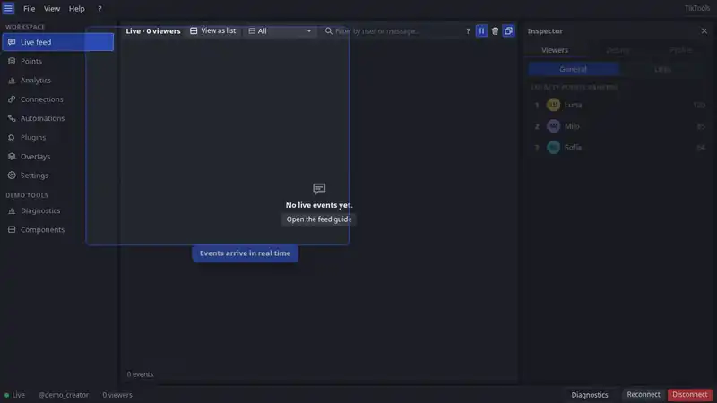

<span id="tiktools"></span><span id="tiktools-"></span>
# TikTools

TikTools connects your Windows or Linux desktop to a TikTok LIVE: it shows
chat and engagement events, keeps viewer points, and runs automation rules
locally on your computer. An optional native CLI adds a headless workflow,
including Termux on Android.

[Download a release](https://github.com/nglmercer/TikTools-app/releases) ·
[Latest stable](https://github.com/nglmercer/TikTools-app/releases/latest) ·
[Interactive demo](https://nglmercer.github.io/TikTools-app/demo/)

[](https://nglmercer.github.io/TikTools-app/demo/)

Documentation in your language:
[English](docs/content/en/user/index.md) ·
[Español](docs/content/es/user/index.md) ·
[Português](docs/content/pt/user/index.md) ·
[Français](docs/content/fr/user/index.md) ·
[简体中文](docs/content/zh/user/index.md) ·
[日本語](docs/content/ja/user/index.md)

<span id="what-it-includes"></span><span id="what-it-includes-"></span>
<span id="quick-start"></span><span id="quick-start-"></span>

## For users

Released binaries do not need Rust, Cargo or Bun. The path:

1. **Install** — pick a release asset for your system and follow the
   [installation guide](docs/content/en/user/installation.md).
2. **Connect** — enter a creator who is LIVE in
   [your first LIVE](docs/content/en/user/first-live.md).
3. **Explore** — feed, points, automations, overlays and plugins:

| Guide | What it covers |
| --- | --- |
| [Live feed](docs/content/en/user/live/feed.md) | Inspect events, filters and the viewer inspector |
| [Points](docs/content/en/user/points/rules.md) | Viewer point rules, rankings and statistics |
| [Automations](docs/content/en/user/automations/index.md) | Events, actions, variables and templates |
| [Overlays](docs/content/en/user/overlays/index.md) | Widgets and Browser Sources for OBS |
| [Plugins](docs/content/en/user/plugins/index.md) | Install optional integrations |
| [Cloud](docs/content/en/user/cloud/account.md) | Account, backups and shared library |
| [Settings](docs/content/en/user/preferences/index.md) | Preferences, backups and restores |
| [Termux](docs/content/en/user/termux.md) | Native CLI workflow on Android |
| [Updates](docs/content/en/user/updates.md) | Manual updates and their limits |

Something broken? Open **Diagnostics** in the app and start with the recovery
section of the matching guide.

<span id="documentation"></span><span id="documentation-"></span>

## Documentation site and demo

The full documentation and an interactive demo with fictional data live in
this repository. To browse them locally:

```sh
TIKTOOLS_SITE_ALLOW_DIRTY=1 bun scripts/task.ts site build
bun scripts/task.ts site preview
```

Then open [the docs](http://127.0.0.1:4173/TikTools-app/en/user/) or
[the demo](http://127.0.0.1:4173/TikTools-app/demo/). Details:
[docs and demo development](docs/content/en/developer/demo.md).

<span id="commands"></span><span id="commands-"></span>
<span id="development-quality"></span><span id="development--quality"></span><span id="development--quality-"></span>
<span id="project-layout"></span><span id="project-layout-"></span>
<span id="runtime-plugin-model"></span><span id="runtime-plugin-model-"></span>
<span id="data-and-privacy"></span><span id="data-and-privacy-"></span>

## For developers

Requirements: Bun 1.4.4, Rust 1.95+, platform toolchain per
[development setup](docs/content/en/developer/setup.md).

```sh
bun ci          # install from the committed lockfile
bun run start   # desktop host + Vite dev server
```

| Guide | What it covers |
| --- | --- |
| [Developer overview](docs/content/en/developer/index.md) | Architecture and how to choose your dev loop |
| [Setup](docs/content/en/developer/setup.md) | Platform toolchains and first build |
| [Testing](docs/content/en/developer/testing.md) | Unit, contract, E2E and site verification |
| [Control API](docs/content/en/developer/control-api.md) | Typed JSON-RPC surface every client uses |
| [Agents & SDK](docs/content/en/developer/agents.md) | Build scripts/agents against the host |
| [Plugins](docs/content/en/developer/plugins/quickstart.md) | Author runtime plugin packages |
| [Frontend](docs/content/en/developer/frontend.md) | Vue structure, stores and conventions |
| [Contributing](docs/content/en/developer/contributing.md) | Checks, CI requirements and release policy |

Example plugins live in the separate
[`plugins-example-tiktools`](https://github.com/nglmercer/plugins-example-tiktools)
repository; the app and its CI work without it.

## License

[MIT](LICENSE)
