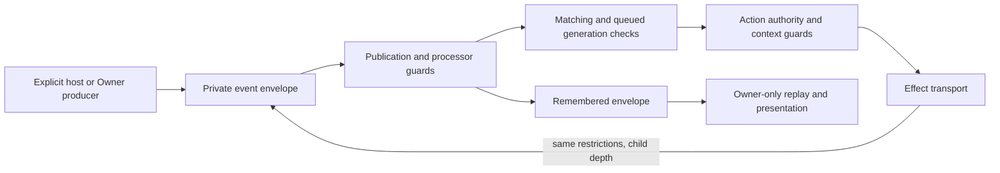

# Collaborative automation and delegated execution

Date: 2026-11-08.
Status: behavior revisions, checked owner editing, exact-definition execution
admission, durable single-record owner commands, scoped remote status summaries
and durable whole-event disable/delete are implemented. Trusted provenance,
durable disabled remote drafts, explicit owner adoption and runtime quarantine
are implemented. The owner now reviews trusted provenance and complete saved
dependencies in the Automations UI, with a host-native adoption intent journal.
The isolated native controller now has a summary board,
captured event confirmation and a preserving
version-4 intent journal. A private native JSON proposal editor submits disabled
author copies. Owner-only execution-manifest previews and persisted subject resolution are
implemented. Private execution contexts now travel through event publication,
queues, enrichment, actions, nested emits and remembered events. Manifest
approval/activation/revocation and a closed log/delay/points/HTTP/audio execution
policy are implemented. Its v3 extension adds exact-topic scoped emits and
bounded scripts, preserving inherited grants through downstream rules. The Owner approval native
coordinator/UI are now implemented, with atomic source/effect/grant review,
explicit dependency state plans and original-result recovery. Wider effect
policies, HTTP response emission, delegated plugins and remote activation remain unfinished. The
release acceptance matrix remains open. Atomic Owner profile/template library
transitions, native recovery and CLI imports are implemented contracts under
validation; their executed evidence belongs in the
[validation record](LIVE-COLLABORATION-VALIDATION.md).

The current implementation and exact API/SDK receipt contract are in
[delegated approval and activation](LIVE-COLLABORATION-APPROVAL.md). Approvals
preserve author provenance, bind final enabled definitions and current grant/
configuration revisions, and invalidate on reverse dependency changes.
Approved rendering/filtering uses public scalar fields and empty globals;
points authorize every subject at the ordered durable writer. Scoped outcomes
are presentation-only and never invoke plugin observers, including bulk history
published by a later Owner action. The earlier context foundation below
describes the generic guard, which remains Owner-only for unsupported effects.
Custom-topic delegated rules accept only approved scoped input and need an exact
topic grant from every author. Script-derived HTTP keeps a conservative flow
requirement for all public input fields, including through nested emitted events.

## Actual execution paths

`workflows.*` currently persists graph-editor records in `automation_workflows`.
Inspection found no host graph interpreter consuming those records. Changing a
graph's enabled flag is not evidence that its nodes execute. Do not enable remote
graph editing by assuming that its storage permission authorizes arbitrary host
execution.

The active LIVE automation path is separate:

1. `automation_runtime/dispatch.rs` matches persisted behavior events.
2. Their `actionIds` resolve behavior actions in `AutomationService`.
3. `automation_runtime/execution.rs` performs core logging/emission, points,
   delays, scripts, HTTP, audio or plugin actions on the host.
4. A script is a bounded QuickJS evaluation, but its returned emit/audio/fetch
   intents can still produce host effects. Treat it as an execution surface.

The existing owner fire/test paths also use this runtime. Synthetic owner fire
intentionally permits an unsaved/disabled event draft; it does not grant that
exception to a remote caller or bypass trusted provenance for a known delegated
event/action ID or dependency. Remote `automation.fire`, unrestricted scripts
and generic action forwarding remain denied.

## Implemented consistency contract

Behavior actions and events retain their existing tables and JSON payloads in
`tiktok-automation.db`. Their resource versions use
`{kind:"automation",scope:"action"|"event",id,revision}`. Identical IDs in the
two families are distinct resources. Revisions are persisted positive integers
serialized as decimal strings; missing never-created IDs return zero and deleted
IDs keep their tombstone. Migration seeds existing rows once without changing
their payload, enablement or higher retained revision.

Every existing Rust/legacy IPC writer now reaches the same operation path:

- Create rejects an existing ID; update requires a present record. The legacy
  explicit save operation remains an upsert. A checked recreation must match the
  retained tombstone rather than assuming revision zero.
- Save, toggle and delete compare the optional owner `expectedRevision` in an
  immediate SQLite transaction. The business change, version and metadata outbox
  reservation commit together with SQLite `synchronous=FULL`.
- Deleting an action removes all of its event references in that same
  transaction. Each changed event advances its own revision and reserves an
  invalidation; the delete response includes all affected event versions after
  the primary action version. Enablement comes from the canonical SQL column,
  never an older `enabled` value left in legacy payload JSON. Deleting an action cannot silently
  reenable a disabled event. Malformed affected state or failed reservations roll
  back the entire deletion/cascade.
- Bulk enablement spans both families in one transaction, reports absent IDs,
  and reserves versions for every applied target. One failed row/version/outbox
  write rolls back both families. The API caps a batch at 512 and rejects a
  singular `expectedRevision` for this multi-resource operation.
- Metadata delivery classifies behavior saves, toggles, deletion and reference
  cleanup. Retrying delivery imports/publishes metadata only; it never invokes an
  action, script or LIVE pipeline. Existing workflow/point command queues remain
  separate from resource delivery.

The owner `automation.list/get/snapshot/create/update/delete/enable/disable` APIs
now return envelope `meta.resourceVersions` while preserving domain result shapes.
`list` and `snapshot` read actions, events and versions from one SQLite read
transaction. `get` of a missing record returns `automation_not_found` with the
permitted local tombstone metadata. Single-record mutations accept optional
`meta.expectedRevision`; bulk declares exclusive-transition semantics. Legacy
local callers can omit a precondition and still advance versions.

Single-record create/update/delete/enable/disable also accept durable command
metadata: `commandId`, `hostInstanceId` and `expectedRevision` are all required
together. Durable create requires an explicit canonical record ID; the legacy
owner create path can still generate an ID. The existing shared principal/ID
namespace and capacity span workflow, points and behavior commands. Business
changes, result/versions, command outbox and primary-resource association commit
in the same immediate FULL SQLite transaction. An owner action deletion also
retains its dependent event versions. Bulk remains an exclusive transition and
does not accept durable IDs or a singular revision.

Original results are retained for seven days; compact IDs remain reserved.
Original-ID retry returns the retained result and never reinstalls historical
definitions or changes a later owner edit. New IDs are fenced to the current host
instance. `collaboration.commands.get` rechecks current principal/read/resource
scope before reading historical bodies and again before egress, including expired
outcomes. Replays and audit delivery do not dispatch actions.

## Implemented remote status, disabled drafts and event deactivation

Remote `automation.list/get` expose only the closed summary
`{kind, id, name, enabled, definitionRedacted:true}`. Name is limited to 160 Unicode
characters. SQL reads canonical status columns, without materializing arbitrary
payload JSON. Config, source/scripts, action dependency IDs, catalogs and plugin
settings are absent. These summaries MUST NOT be used as editable definitions or
round-tripped into owner save operations. Local owner reads retain full bodies.

`resources.automation` uses exact qualified IDs: `event:<raw-id>` and
`action:<raw-id>`. Raw IDs are canonical, at most 128 UTF-8 bytes; colons inside a
raw ID are permitted. Same raw IDs in both families remain distinct. Bare legacy
restrictions are rejected on edit and never match either family; they are not
upgraded to broader permissions. An absent restriction key allows all resources
within the capability; an empty set allows none. Automation is global, so a grant
restricted by `resources.live` cannot read/control it.

Remote `automation.disable` and `automation.delete` require durable metadata,
`automation.read`, exact **event** permission and respectively `automation.toggle`
or `automation.edit`. Only complete events can be deactivated/deleted remotely.
Removing/disabling an intermediate action can remove a delay or guard and change later effects; these
deactivation/deletion operations remain denied even with every capability.
Disabled definition authoring is a separate operation described below. Enable,
bulk, fire/test, owner snapshot/context/runs, authority inspection/adoption and
script/catalog methods remain denied remotely. Live authorization is checked
again after SQLite writer admission and immediately before queued output.

Hello advertises `automationSummary`, `automationDrafts`,
`automationEventDeactivate` and the `automation` recovery domain on persistent
hosts. Immutable `collaboration.snapshot`
pages include an optional `automation` summary array and matching family-scoped
versions. `automation.changed` contains `{id,kind,change}` metadata only; retained
replay uses the existing subscription sequence/gap rules. Command notifications
are private to their principal; resource invalidations reach other permitted
controllers without that principal's command ID. Grant changes require a new
baseline. The SDK validates closed summaries, domains, versions and distinct
`(kind,scope,id)` keys across pages before publishing its baseline.

These reads/commands are available over the remote API/SDK/CLI and the isolated
native desktop controller. Its **Host automations** board shows permitted status,
with actions read-only and explicit event disable/delete confirmation. It never
opens the owner definition editor. The version-4 journal preserves previous
workflow/points/event IDs and history while adding fixed proposal operations.

The native controller also presents the host LIVE connection status when its
current grant includes `live.read`. Its dedicated read-only RPC compares the
selected epoch, connection, host, principal, session and grant before and
after the remote read, validates the closed result, and enforces any LIVE
creator restriction. The panel polls every two seconds while connected and
clears on selection, reconnection, permission or read failure. It does not
start or stop a LIVE, and the status poll is not a real-time event feed.

For unrestricted `live.read` grants, the controller also displays a bounded
read-only activity feed from `ui.feed.backfill`. Native projection enforces the
same host/session/grant fence as status, denies creator-restricted grants,
preserves cursor precision with decimal strings, limits pages to 64 items and
exposes only bounded text fields. The UI retains at most 100 rows and identifies
missed history or host cursor reset; it polls rather than subscribing to a
push stream. The host's bounded history may include an earlier LIVE session,
and the list does not authorize moderation actions or establish physical
two-PC acceptance.

## Implemented provenance and disabled authoring

`behavior_provenance` is host-owned SQLite data, independent of editable action
and event JSON. Its family/ID key retains an owner or delegated authority and a
positive generation. Delegated authority records the authenticated principal
and authoring session. The type is not deserializable from a command body;
authority-looking fields in a submitted definition grant no authority.

A migration marker seeds existing behavior identities, including retained
resource tombstones, as owner-owned once. It does not change their definitions
or enablement. Later startups do not fill missing historical sidecars as owner
records. Every behavior revision transition advances the authority generation
in the same business transaction. Ordinary owner save/update, toggle, bulk
enablement, delete and same-ID recreation preserve provenance. Deletion retains
it; a delegated tombstone cannot become an owner identity through recreation or
an inline draft with the same ID.

Before runtime installation, the same read transaction validates the retained
catalog: every live definition needs a positive live version and trusted
authority; every live version needs a body; every tombstone needs no body and
valid authority. Sidecars require matching versions, including Owner tombstones
omitted from the execution map. Legacy version seeding runs only within the
one-time authority migration; later startups do not repair missing history.
Any inconsistency quarantines execution while ordinary owner reads remain
available for definition review and persisted plugin-state restoration.

Remote `automation.create/update` now accept **explicitly disabled** action or
event drafts: the submitted record must contain `enabled:false`. They require
the complete durable metadata tuple, `automation.read`, `automation.edit`, the
exact family-qualified resource permission and a grant without a LIVE resource
restriction. Current authorization is rechecked inside the writer transaction.
New IDs become delegated before commit; subsequent writes may edit only the
same principal's delegated identity. Owner-owned IDs and another principal's
IDs/tombstones cannot be overwritten, regardless of the candidate JSON.

Fresh delegated drafts validate their editor-facing structure before saving:
actions require a canonical nonempty `typeId`, events a canonical nonempty
`trigger` (128 UTF-8 bytes maximum, no wildcard/control characters). Unknown
plugin/type names remain valid proposals. Actions default `config` to an object
and schema version to 2 (versions 1/2 accepted). Events default schema version 1,
empty action/filter arrays, zero cooldown, global scope and all-actions mode.
Known arrays/filters, enums, schema versions and finite nonnegative safe cooldown
numbers are checked; arrays are bounded to 512 entries. Unknown top/filter
fields remain available for exact review. This prevents a weaker remote editor
from inserting malformed shapes that break the owner's structured projection;
it does not approve any effect. Validation runs after permission/ownership and
original-ID replay inside the writer transaction. Owner legacy definitions and
historical receipts are not rewritten or revalidated.

Remote action authoring also rejects an ID referenced by an owner-owned or
another principal's event, including disabled events and unresolved references.
Dependency inspection is bounded and fails closed for malformed, missing or
oversized state; denial does not disclose inspected definitions or dependency
IDs. This protects existing owner graphs from changes to a referenced draft.

The result is only `{id,kind,enabled:false,pendingReview:true}` with the committed
resource version. Reads and recovery still expose closed summaries or that
minimal receipt, never definition bodies. Draft creation/update shares command
ID fencing, retained outcomes and outbox delivery with the existing behavior
commands. Retrying the original ID cannot restore an earlier draft or execute it.
This API stores a proposal; no delegated execution is enabled by its receipt or
by changing its SQL enabled flag through an ordinary owner operation.

Local `automation.authority.get` returns `{kind,id,provenance}` and the matching
resource version from one read transaction. Provenance contains the trusted
authority and a decimal-string generation; absent provenance is `null`. This
method is owner-only and does not accept mutation metadata.

Local `automation.adopt` explicitly transfers a present delegated definition to
owner authority. It requires `acknowledgeAuthority:true` and complete durable
command metadata with the reviewed `expectedRevision`. The transaction clears
delegated identity, advances revision/generation, reserves invalidation and
**leaves the record disabled**. Enabling it is a separate checked owner command.
This does not activate automatic saved-trigger execution. After authority
transfers, explicit owner fire/test operations retain their existing enablement
and test rules; adoption is not a sandbox against the owner.
Already owner-owned records do not acquire a new authority transition. Adoption
is a transfer to the owner's execution authority, not approval to execute under
a remote principal's grants. Adopting an event does not adopt its actions; every
delegated dependency still blocks execution until separately resolved.

## Owner review and native adoption recovery

The local Automations page exposes **Review saved authority** and a persistent
adoption-history surface, including when no record is selected. Review reads the
saved definition rather than the unsaved editor candidate. Opening/adopting does
not save or replace that candidate. The dialog displays trusted authority,
principal/session, provenance generation, primary revision and the full source
of every referenced action, including disabled steps and unselected branches.
Missing or retained deleted dependencies are shown explicitly. JSON is escaped
text. No source, credential or pending command ID is stored in browser storage.

Owner-only `automation.review {kind,id}` captures
`{kind,id,record,provenance,dependencies:[{id,record,provenance}]}` and the primary
plus dependency versions in one read transaction. Dependencies follow first
occurrence in `actionIds`, with duplicates removed from the review list. Missing
records are null; never-created references have revision zero, while tombstones
retain their version and provenance. The read is bounded to 512 distinct
references, 256 KiB per definition and 4 MiB total. Malformed or inconsistent
selected metadata fails without returning a partial review; unrelated corrupt
records do not prevent inspection for repair. This read never installs runtime
authority and remains denied remotely.

Generic `automation.adopt` now accepts optional `reviewedVersions`. When supplied,
it must exactly match the primary and every reviewed dependency, including
missing/tombstone references, in the review's order. The writer checks them in
the same transaction as authority transfer. A changed dependency rejects the
adoption even when the event revision stayed unchanged. Bindings participate in
the command hash; an old ID cannot be reused with a different review. Omitting
the field preserves the earlier primary-only local-owner API and its hashes.

The UI uses a host-owned coordinator rather than choosing durable IDs itself:

- `automation.adoption.get {}` returns host/instance identity, one pending intent
  and at most 16 resolved metadata records.
- `automation.adoption.submit` requires `kind`, `id`, `expectedRevision`, captured
  `hostId`/`hostInstanceId`, the complete `reviewedVersions` array and explicit
  `acknowledgeAuthority:true`. The host mints an ID and persists its metadata
  before dispatching the existing adoption command.
- `automation.adoption.resolve {}` queries that original command only. Neither
  reload, restart, resolution nor metadata replay resends adoption.
- `automation.adoption.review_unknown {commandId,acknowledgeUnknown:true}` makes
  a final result lookup and archives a genuinely unresolved outcome. A newly
  available success wins over a stale unknown acknowledgement. Archival neither
  undoes work nor claims that it failed.

One unresolved intent blocks new coordinator submissions across owner windows.
Intent, host binding and private semantic hash live in `owner_automation_adoptions`
in the host automation database; the shared business ledger retains the result.
Insert failure prevents dispatch, and result-record failure preserves the
original pending identity. Historical receipts cannot replace current source or
reenable/disable a later owner change. Caller-selected command metadata is
rejected for these four coordinator methods. Remote callers and the isolated
controller bridge cannot use them.

The UI invalidates consent when observed source/dependency versions or host
identity changes, rereads the full saved review before submission, and sends
the same complete bindings to the writer. Adoption does not enable the record;
automatic operation still uses a separate checked owner enable. Explicit owner
fire/test keeps its normal rules after the authority transfer. This is an owner
transfer workflow, not delegated execution-manifest approval.

The controller board remains summary-only. Its separate private proposal editor
uses author text and fixed create/update bridge methods, with explicit storage,
base and sending consent. The version-4 shared journal preserves original IDs
for outcome lookup without resending source. It cannot adopt definitions; the
host-native owner journal is separate. See the
[native proposal contract](LIVE-COLLABORATION-CLIENT-COMMANDS.md#native-automation-proposal-editor).

## Atomic Owner library transitions

The local Owner's profile and custom-template catalog now resides beside the
action/event graph in `tiktok-automation.db`. `automation.library.snapshot {}`
returns `{hostId,hostInstanceId,revision,definitionDigest,catalog,definitions,resourceVersions}`.
The catalog is `{packs,activeId,templates}`; packs contain
`{id,name,description,eventIds,actionIds}`. Catalog, full saved definitions and
their family-qualified versions come from one SQLite read transaction. The host
then adds the runtime catalog for display. This is an Owner source review;
remote principals and the isolated controller cannot use any library method.

`automation.library.submit` accepts the closed wrapper
`{mutation,expectedRevision,definitionDigest,hostId,hostInstanceId}`. The exact
catalog revision and complete definition-universe digest are both required:
ordinary edits, newly appearing IDs and deleted IDs invalidate the reviewed
universe even if catalog membership did not change. The eight mutations are:

| `mutation.operation` | Remaining mutation fields | Effect |
| --- | --- | --- |
| `create-profile` | `id,name,description` | Add an empty named pack |
| `switch-profile` | `id` | Rewrite enabled states over the full live action/event universe and select the pack; Default selects unowned records |
| `delete-profile` | `id` | Delete its live graph members, coalesce action-reference cascades and remove membership |
| `apply-template` | `entry,profileId,additionalEntries?,templates?` | Create the exact staged graph and assign it to the requested pack or Default; optional graph/gallery additions share the transaction |
| `import-profile` | `profile,entries,templates?` | Create staged entries, replace that pack's descriptor/membership, select it and optionally update the gallery |
| `assign-record` | `kind,id,profileId` | Assign an existing unowned record to an existing named pack; Default/already-owned assignment is a checked no-op |
| `import-templates` | `templates` | Upsert gallery documents by their exact IDs |
| `delete-template` | `id` | Remove a gallery document; an absent ID is a checked no-op |

An entry is `{actions:[fullRecord...],event:fullRecord}`. Its event references
its exact ordered staged action IDs. `additionalEntries` permits up to 31 more
entries after the primary; profile imports permit up to 32 entries. Optional
gallery batches permit up to 128 documents. Duplicate gallery IDs within one
submission fail; an existing gallery ID is replaced under the reviewed catalog
CAS. UI collision handling stages fresh IDs before submission; the host never
regenerates IDs or transforms a collision into a create/update fallback.
New graph targets require revision zero and cannot reuse retained tombstones.

The host persists a metadata-only native intent before dispatch. One immediate
FULL-synchronous AutomationDB transaction checks command identity, catalog CAS
and the complete universe digest, then writes definitions, catalog, retained
versions/provenance, approval invalidations, command result and both outboxes.
Every accepted mutation, including a checked no-op, advances the catalog once.
Existing source retains its trusted authority; switching, deleting or importing
does not adopt a delegated record or authorize execution. Only the exact
`automation/library/catalog` version is exempt from behavior provenance and
must match the canonical catalog revision/deleted state; unknown scopes fail
closed.

Delete-profile removes all target member IDs, including already absent IDs,
from every remaining pack. Multiple deleted actions cause at most one final
revision per surviving affected event. References to an already absent action
are not an invented deletion cascade. Fresh graph creation clears its newly
created IDs from stale memberships in every existing pack before honoring the
explicit requested pack or Default. Replacing an imported pack leaves its old
graph present and unowned unless another pack still owns it. Ordinary assignment
does not implicitly transfer ownership between packs.

The first catalog access copies the three retained PointsDB `app_state` keys
`behavior.profiles.packs`, `behavior.profiles.active` and
`behavior.templates.custom` once into a revision-zero AutomationDB catalog.
Legacy data is retained untouched. Duplicate identities, malformed documents
and oversized/corrupt state fail without dropping selected entries or partially
initializing the catalog. Subsequent legacy reads project the three values
coherently from the canonical catalog. Generic state reads never allocate the
retained legacy blobs. A legacy reserved-key write is typed and commits one
catalog revision plus invalidation in AutomationDB before acknowledgement;
persistence failure cannot be reported as a successful memory-only save.
Separate legacy key writes do not form a multi-key atomic operation.

The native methods `automation.library.get`, `.resolve` and `.review_unknown`
use the same metadata-only state shape as the other Owner journals, with one
pending intent and at most 16 recent records. Review-unknown requires
`{commandId,acknowledgeUnknown:true}` and performs a final original-result lookup.
All four Owner journals—adoption, approval, single definition and library—check
each other's pending state atomically and share UI admission. Reload, recovery
and uncertainty archival neither recover source nor replay a mutation. A new
attempt requires current saved-state review and fresh consent; staged IDs stay
frozen for the original attempt. Caller-generated command metadata is forbidden.

A fresh success may return `{state,acknowledgement}`. The acknowledgement is
`{value,resourceVersions,command,hostInstanceId}`, where value is
`{revision,catalogDigest,definitionDigest,versionsDigest,affectedResources}`.
Its version vector starts with `automation/library/catalog`, followed by unique
final action/event versions sorted by `(scope,id)`. The count includes catalog.
Recovery verifies the immutable original result's operation/target/base/digest
bindings and returns metadata history, without installing historical source.
The retained business envelope contains these bindings and the receipt only.

Library hashes use SHA-256 of canonical JSON: object keys sort by Unicode
scalar value, arrays preserve order, strings use ordinary JSON escaping,
integers retain exact native decimal values and finite floats use ECMAScript
shortest formatting (`1.0` becomes `1`, `-0` becomes `0`). The command hash covers
`{method:"automation.library.apply",params:{mutation,definitionDigest},expectedRevision}`.
The definition digest covers ID-sorted full `actions`/`events` and family/ID-sorted
definition versions; the catalog digest covers the catalog, and versionsDigest
covers the exact primary-first receipt vector. This encoding is private to the
new library protocol; older command hashes retain their existing contracts.
Browser review refuses source integers outside its safe display range rather
than silently approving rounded data; native integer inspection stays exact.

The source/snapshot budget is 8 MiB and the catalog budget is 4 MiB. Newly
created graph records and submitted templates have a 256 KiB/depth-64/65,536-node
bound. Explicit new graph batches contain at most 512 targets; existing
workspaces, switches, deletes and snapshots have no 512-record universe cap.
Retained legacy rows can exceed the new-record byte bound while still fitting
the bounded snapshot. Rewritten toggle output must fit the record bound. SQL
byte admission precedes source decoding. Final serialized versions must fit
8 MiB minus 256 KiB of native result/history headroom. Under the host writer,
the coordinator measures current runtime-catalog overhead and subtracts it
from the complete post-write snapshot budget before commit, in addition to
8 KiB envelope headroom. Oversized results roll back the whole business change.
Independent later runtime-catalog changes remain separate changes.

CLI template/profile imports now stage all IDs, obtain one current snapshot and
submit one library mutation, including optional saved gallery documents and
profile registration. Actual imports and dry runs measure resolved record JSON
before allocating expanded strings or cloning sole-parameter trees, sharing an
8 MiB entry budget across the whole import. Inline object interpolation counts
its serialized text with outer-string escaping and guards raw depth/nodes before
serialization; repeated small placeholders cannot bypass per-record limits.
They no longer report a sequence of graph saves and a
PointsDB pack write as an atomic import. The Owner editor's ordinary definition
save and later profile assignment remain distinct confirmed operations. A known
successful save stays saved if membership assignment fails; assignment is staged
explicitly and cannot silently resubmit the definition.

Implementation: [native coordinator](../crates/tiktools-core/src/control/owner_library/runtime.rs),
[catalog/migration](../crates/tiktools-core/src/db/sqlite/automation_library.rs),
[atomic business transition](../crates/tiktools-core/src/db/sqlite/behavior/library.rs),
[native journal](../crates/tiktools-core/src/db/sqlite/owner_library.rs) and
[API contract](CONTROL_API.md#native-owner-library-api).

## Implemented execution admission

The runtime installs actions, events, trigger ownership and active-plugin state
as one atomic index. Each indexed definition has a host-generated token, distinct
from caller JSON and from the persisted resource version. A no-op projection read
keeps tokens. Changed definitions/revisions, delete/recreate and referenced action
changes invalidate old event tokens, including changes to a nonselected branch
of a random-action event. Unrelated action edits do not cancel that event.

Matching captures the exact event and selected action bodies/tokens together.
Admission checks those tokens before cooldown claim and again before each
unstarted action. Editing an action while an earlier delay is awaiting does not
execute either the old pending effect or its stronger replacement. Removing and
recreating identical JSON does not make an earlier queued token valid again.
An explicitly fired owner draft bypasses saved-event enablement only; referenced
actions still need their original live tokens.

Record writers and index installation share a dedicated mutation gate. An
odd/even write epoch plus notifications prevents admission from seeing an old
index after a new row commits. Waiting admission yields asynchronously rather
than blocking a Tokio worker on database I/O. The audit/publication barrier is
independent, so audit delivery does not hold action admission. Shutdown wakes
waiters; poisoned/exhausted epochs fail closed. No lock spans an action's await,
HTTP call, plugin dispatch or media playback. Already admitted owner actions can
finish; final per-intent delegated authorization is still required below.

Persistent runtime refresh reads definition bodies, resource versions and trusted
provenance in one SQLite read transaction. Installation publishes the index and
its owner-authority map together. A delegated event or any delegated action
reference quarantines the complete event, including disabled references and an
unselected random branch. Live matching, manual fire/test, direct action
execution and inline drafts with known delegated IDs cannot bypass this check.
Admission rechecks current authority as well as definition tokens.

Hotkey bindings are derived from that trusted owner-only index, excluding both
delegated events and owner events that depend on delegated actions. Missing
authority for a stored definition fails closed. A failed runtime snapshot read
quarantines the index and manual/inline admission until a successful trusted
refresh; it does not continue with a stale owner projection. Restart does not
reseed a missing sidecar after the migration marker is present.

This is quarantine, not a delegated interpreter. There is no approved-manifest
path that executes a delegated rule under a live remote grant. Explicit owner
adoption is currently the only authority transfer that can make such a
definition eligible for the existing owner runtime, with enablement and all
dependency checks still applied separately for automatic execution. Explicit
owner fire/test retains its documented disabled-draft exceptions after adoption.

Without persistence, legacy owner behavior records use the atomic in-memory
index and the same execution tokens. Persisted revision preconditions are
unavailable rather than simulated. This does not enable remote mode without
its required persistence.

## Execution subject resolution and manifest preview

`automation.manifest.get {kind,id}` is an owner-only metadata-aware read. It
starts from the same atomic saved definition/provenance/dependency review used
for adoption. The primary record, every distinct direct action reference and
their versions retain first-reference order, including disabled, unresolved,
deleted and random-unselected dependencies. The method does not accept source,
grants, subjects, approval hashes or command metadata. Remote callers remain
denied even with every capability. A missing primary is not an empty Owner
manifest.

The policy-versioned preview binds host identity, all delegated principal/session
subjects and current grant revisions. Every definition binding has family, ID,
revision, presence, canonical content digest and trusted provenance generation.
Digests use domain-separated SHA-256 over deterministically sorted JSON, with
bounded depth/bytes. Full source, configuration, scripts and plugin setting
values are absent from this response; they remain available through the separate
owner saved-source review. This read must remain owner-only: definition digests
must not become a way to guess private configuration through remote output.

The builder describes known log, emit, points, delay, script, HTTP, audio and
plugin/unknown effects with closed decisions/reasons and template field names.
It intersects supplied subjects' current capabilities, exact resource restrictions
and points limits for the policies that exist. Dynamic targets, opaque scripts,
unrestricted globals, missing references and unsupported policies are explicit.
A type name does not prove plugin ownership: descriptor/artifact/permission and
settings-generation bindings remain unavailable and block that path. No secret
setting value or secret-value hash is read to stand in for those bindings.
`executionAuthorized` is always false. A preview, a classified effect or an empty
subject list does not grant execution or transfer trusted provenance.

Saved author authority is now distinct from request authentication. Host-only,
non-deserializable `ExecutionAuthorization` / `ExecutionAuthorizations` handles
resolve exact persisted principal/session pairs in the owning host service.
Snapshots check enabled collaboration, both revocation flags, current validated
grant/revision and absolute/idle deadlines. They neither require a bearer token
nor update session activity. Token expiry/refresh rotation or closing a socket
does not itself invalidate that saved session identity; session expiry, host
disable, grant changes and revocation still apply. Reopening the host can resolve
the same saved identity from storage without retaining credentials. The current
session lifetime remains bounded by the existing seven-day absolute and one-day
idle limits; preview/execution checks do not renew it.

Batch resolution covers up to 513 supplied identities and deduplicates exact
pairs. One invalid/expired subject rejects the entire batch. Stored grants and
aggregate parsing are bounded before returning any identity. An all-Owner closure
has no remote subjects and returns an explicitly empty set, never an invented
Owner grant. Identity snapshots alone are descriptions of current state, not
durable approval or final-effect admission.

The batch `with_current` path keeps one collaboration DB mutex through a
synchronous admission callback, ordering it before/after grant, disable and
revocation commits. It avoids nested single-subject lock acquisition. Future
business writers acquire their writer before this callback and import audit or
outbox work after releasing it. Callbacks must not await or reenter collaboration;
long work must recheck captured deadlines immediately before its final sink.
This ordering proves only synchronous admission, not subsequent network dispatch,
completion or exactly-once external effects. The future runtime must also honor
host shutdown and retain these contexts through nested effects.

Approval persistence/invalidation, plugin bindings, filtered globals and final
effect enforcement remain required before activation. Existing delegated runtime
quarantine is unchanged. Explicit Owner adoption remains a separate authority
transfer and must not be presented as delegated manifest approval.

## Trusted runtime context and event envelopes

The runtime projection now retains trusted authority, exact principal/session,
provenance generation, resource revision and tombstone state instead of reducing
them to an Owner boolean. Bodies, versions and authority are checked together
before index installation; an inconsistent trusted installation quarantines the
index. Authority-only changes invalidate queued definition generations and
dependent events even if editable body and resource version happen to match.
Retained delegated IDs cannot become Owner inline work. Explicit inline Owner
work has no manufactured persisted revision or provenance generation.

`AutomationEvent` carries event JSON beside a private, non-serializable and
non-deserializable `ExecutionContext`. Publication, domain fan-out, queues,
processor enrichment and remembered-event writes require this envelope. Native
LIVE, competitions, native plugin poll/push and explicit Owner fire are trusted
producer sites and construct Owner contexts explicitly. There is no implicit
Value-to-Owner conversion. JSON `authority`, `source`, `executionAuthorized` and
`data.depth` fields cannot construct or erase the private context.

Context intersection treats Owner as neutral, denial as absorbing and scoped
subjects conjunctively. Subject batches can intersect only under the same
owning service `Arc`; equal host labels do not combine separate admission locks.
Every subject survives intersection and still resolves current session state.
An empty subject set cannot construct a restricted grant or become Owner.
Trusted child depth increases independently of JSON, cannot reset at a nested
boundary and refuses further emits at the limit. A pasted depth value is display
data, not an execution-authority or loop-control credential.

Core emits, script emits/results and the existing Owner HTTP response/plugin
paths carry explicit context into typed child events. Approved scoped HTTP
response emission remains unavailable pending a response-read/flow policy.
The HTTP sender, audio,
plugin/native invocation, declarative HTTP and plugin-intent handlers require
explicit context. Guards precede templates, settings, observations and effects;
plugin results are checked again after invocation before progress/intents. The
globals snapshot itself now requires context, including plugin-intent and
declarative-HTTP rereads. Host shutdown blocks new work at these boundaries.
Processor authority failures fail closed; ordinary processor failures still
retain the original event data under the same context.

Remembered latest/per-type events retain complete private envelopes. Owner
context panels, manual replay and native poll-context getters filter scoped
events rather than returning their payload as new Owner input. Approved scoped
emits use a separate public-projection presentation/matching path that bypasses
executable observers and processors. Scoped writes into Owner preview memory
remain denied; retained-memory tests also exercise scoped entries directly to
protect that read boundary.

This context foundation alone is not a delegated execution permit. Unsupported
non-Owner effects remain denied before
unrestricted globals/settings, plugins, observations, rankings, queues or output.
Current-subject snapshots validate identity/lifetime but do not approve a
definition or replace effect-specific capability/resource checks. The later
approval slice now implements persisted core approvals, filtered rendering and
final points authorization through commit. The later HTTP/audio slice adds exact
typed destination/path/option grants and durable accepted/dispatched/outcome
records, with stable trusted native/action identities and no retained-effect
replay. Plugin artifact/settings binding and one-shot workers remain groundwork;
delegated plugin execution is still unavailable without effective isolation.
The v3 extension adds scoped emits, incoming-scoped-only custom triggers and
separately bounded QuickJS evaluation. Emit and Script handoffs have private
metadata-only receipt kinds alongside HTTP/audio. A handoff bound to the complete
evaluated script input/result is reserved before any returned effect; every retained invocation
refuses all returned intents rather than resuming or reordering earlier work.
Delegated VM admission is limited to four concurrent evaluations without a
queued backlog; a busy host rejects before allocating a VM or a Script receipt.
Script-flow restrictions are monotone through context intersection and child
events. Each descendant HTTP sink requires all 18 public input fields within one
complete rule per subject. Captured console/returned logs share bounded budgets,
and returned effects retain their own current capabilities/resources.
Plugin effects, HTTP response emission, remaining domains and full acceptance
remain pending. The
[approval and activation contract](LIVE-COLLABORATION-APPROVAL.md) specifies the
implemented core transition and remaining policies.

## Implemented owner editor

The Automations page keeps its opening record, candidate text and current host
projection separate. Snapshot bodies and family-scoped revisions publish as one
projection, including to synchronous observers. A background refresh never
overwrites the selected editor or advances its base, even before the first edit.
Opening a different selection captures a fresh base.

Single-record saves retain the opening host ID/instance and captured revision.
The persistent Owner editor now uses `automation.definition.submit`; its closed
operation selects create/update/delete/enable/disable for an action or event.
New records keep their explicit generated target ID and use revision zero;
reviewed recreation keeps the retained tombstone revision. Missing updates never
retry as creates. Native revisions are canonical nonnegative decimal strings:
zero describes absence, not permission to overwrite an existing record.
A missing/invalid revision or reviewed host on a persistent or unidentified
host disables submission. Source, revisions and host identity publish together;
an instance replacement with coincidentally equal revisions cannot authorize an
old editor's write. Only a host explicitly reporting
`system.info.features.persistence:false` permits local in-memory editing without
a revision, with a visible run-only notice. That exception is not remote mode
or simulated durable metadata.

Save/delete failures retain the candidate and dirty state. Unconfirmed outcomes
block another submission until native original-outcome lookup and explicit
current read/review. The host generates and durably records the behavior command
ID before dispatch; browser code neither supplies nor persists it. A matching
later definition read establishes current state, while native history proves
the original request's outcome. Neither recovery nor history replays a write.
Successful acknowledgements update only the matching selection's base; text
edited during the request remains unsaved. Navigation, same-ID reopen and
disposal fence late save/read/failure callbacks.

### Native Owner definition intents

The Owner-only methods are `automation.definition.get {}`, `.submit`, `.resolve
{}` and `.review_unknown {commandId,acknowledgeUnknown}`. All remote principals
are denied at ingress and egress, including all-capability sessions. Caller
business command metadata is rejected. Submit variants carry the reviewed host
ID/instance, `expectedRevision` and family; create carries `record`, update
carries matching `id`/`record`, and delete/enable/disable carry `id`. Ordinary
Save, deletion confirmation and toggle confirmation already establish intent;
there is no additional execution-approval checkbox.

`owner_automation_definitions` stores bounded metadata and source fingerprints,
never definition source, credentials or grants. One shared native coordinator
and reciprocal transactional pending checks cover definition, adoption,
approval and library journals. The begin transaction commits before the existing durable
business command runs under command-coordination then automation-writer gates.
Ordinary definition writes preserve trusted provenance; they never adopt a
delegated record or install a delegated execution approval.

The original successful submit may return a verified acknowledgement containing
the actual normalized saved result and complete resource versions. Its separate
`state` contains host identity, one pending intent and at most 16 recent metadata
receipts. Get/resolve/unknown review return only this state. Original-ledger
verification binds principal/session, command/hash/method/host, target, revision
arithmetic and actual source digest. Save/toggle advances the primary revision;
a missing delete returns `deleted:false` without advancing its tombstone.
Action deletion also verifies every sorted affected event version. There is no
513-entry approval-closure limit on those cascades.

Definition source is bounded to 256 KiB, depth 64 and 65,536 nodes. Dispatch
preflight checks legacy toggle output and exact cascade-version bytes under the
writer gate before mutation, reserving room inside the 8 MiB Owner response
budget. The journal entry itself is at most 8 KiB. Expired/missing original
outcomes retain pending state until explicit unknown review; known ledger
success wins over an unknown acknowledgement. Malformed or oversized retained
proofs fail closed. Recovery never substitutes the current definition for an
unavailable historical result.

**Definition changes** opens selection-independent native history/recovery,
also reachable from the narrow editor sheet without discarding a draft. A
recovered result invalidates the current editor's review/base consent and keeps
newer text. All four Owner mutation flows share frontend in-flight admission
and observe each other's pending/recovery state; native admission also covers
independent windows. Source/command identities never enter WebStorage.
Successful definition acknowledgement is kept distinct from subsequent profile
assignment failure, so a profile error does not resend an already-saved record.

Template imports and profile-wide transitions use the separate
[atomic library coordinator](#atomic-owner-library-transitions); the definition
coordinator covers the five single-record operations only. Other domain
ledgers and physical two-PC/platform/load acceptance remain open.

**Compare with host** reads the current body/revision or tombstone and shows the
opening version, candidate and current host definition. The operator can edit
the form to merge desired fields and explicitly choose the reviewed base while
keeping the candidate. That local choice never writes or enables anything.
An absent ID offers **Prepare recreation with this draft**, using its retained
tombstone; **Save** is a separate action. A changed candidate invalidates an
already displayed review. No candidate is automatically saved to disk or Cloud.

Single-record enablement changes require confirmation of the frozen target ID/revision.
Cancel restores the committed checkbox. Conflicts/unconfirmed results require a
fresh read and another explicit confirmation; an already matching current state
does not submit another toggle. Editor deletion uses its pinned base and existing
confirmation. Failure preserves the draft; newer edits made during a successful
delete remain available for review. Owner profile-wide enablement remains its
separate atomic owner transition, not a single-record revision check.

A saved rule's membership assignment is staged separately for explicit library
review using its captured family/ID and requested profile. Changing selection or
profile cannot silently retarget that confirmation. Action/event membership is
distinct for identical raw IDs. Assignment failure does not turn an acknowledged
business save into an unconfirmed write or trigger another definition save.

The owner forms and review are available in English and Spanish; narrow review
buttons retain their full labels. These are local-owner behavior editors. Native
remote JSON proposal editing and owner adoption review now have their separate
surfaces. Broader delegated effect policies and graph execution remain unfinished.
These owner forms do not submit a proposal under a remote identity.

## Implemented native controller contract

The first native automation UI MUST be a separate summary-only board. It MUST
NOT reuse the full-definition owner editor or treat a summary as a local draft.
Key rows by family plus raw ID and give this projection its own display revision;
points refreshes must not invalidate a frozen automation confirmation.

Add explicit `disable-event` / `delete-event` native intent operations, resolving
to automation method, resource kind and the fixed `event` scope. A preserving
journal format upgrade MUST read both previous workflow-only and mixed points
formats, preserve pending/original IDs and recent history, reject new operations
smuggled into an old format, and durably replace the file before dispatch.
Workflow/points/event commands MUST share the existing single pending-intent gate.
No generic RPC or caller-controlled resource scope belongs in the WebView bridge.

A confirmation captures profile/host/session/grant identity, event ID/name, base
revision and desired operation. The native coordinator MUST validate that binding
and current readiness again before journaling/sending, then validate the returned
method/resource/scope/revision and minimal result. A new host, grant or selection
requires review again. Disconnect, reload and process death preserve uncertain
intents; recovery queries the existing ID without sending the mutation again.
Explicit review is required before another operation can replace an unknown one.

Negotiate `automationSummary` and the `automation` recovery domain. Baselines
and per-resource refreshes MUST retain only validated closed summaries and
matching versions. Revocation/scope changes clear inaccessible rows and force a
new baseline. Metadata replay never executes a trigger or action. Events may be
disabled/deleted; actions stay read-only until their own effect policy exists.

The status/deactivation bridge exposes `controller.automations` and
`controller.automation.command` for this domain. Each command fixes the `event`
scope and binds connection, host instance and grant revision. Page reads use an
independent `automationRevision`; native baseline and updates count the same
serialized summary/version wrappers under a 4 MiB projection budget. Points and
workflow updates do not advance that automation revision. Equal/older metadata
already covered by the projection is acknowledged without another read. A changed
set of readable domains rebuilds the stream, including newly granted domains.
The distinct `controller.proposals.*` bridge uses explicit private author copies
and fixed disabled create/update commands as documented above.

Acceptance requires native journal upgrade/crash tests, two-controller TLS
projection/recovery tests, browser confirmation and stale-selection tests, and
an actual Wry/native-journal/host test with private fixtures. Physical PCs and
real OS credential stores remain separate operational gates.

## Required next implementation

The behavior owner editor, trusted provenance and disabled authoring API are
implemented as described above. Native remote JSON proposals and manifest
previews now have their separate boundaries. The closed delegated policy now
supports log/delay/points/HTTP/audio/scoped emits/scripts; broader delegated
execution and full release acceptance remain unfinished.

The following work remains part of the full plan:

1. **Owner definition intent recovery.** Native single-record create/update,
   deletion and enable/disable now have original-ID recovery, complete Owner
   editor integration, host/revision fences and a shared pending gate with
   adoption/approval/library. The eight atomic profile/template library
   transitions and compound CLI imports are implemented under validation above.
   Keep summary bodies separate from definition drafts and finish their complete
   acceptance coverage; this does not complete other domain ledgers or effects.
2. **Complete approval bindings over trusted provenance.** The sidecar, one-time
   migration, retained tombstones, disabled authoring, explicit owner adoption
   and runtime quarantine are implemented. The core approval now binds every
   action dependency; broader approval must also bind each
   action dependency and plugin definition/permission/settings revision, not
   only the event's generation. Use persisted principal/session identity to
   resolve current host authorization across expiry, disconnect, revocation
   and restart. The new non-deserializable batch resolver implements that lookup
   without bearer tokens or activity touches. Its admission is now wired into
   core execution, durable points and the supported HTTP/audio/emit/script
   sinks. Plugin/native-input/TTS and other unsupported paths remain denied.
3. **Execution manifests and approval.** Classify every referenced action,
   script, plugin, resource and host effect. An approved manifest binds exact
   definition revision/hash, principal/session and grant revision. Unclassifiable
   scripts/effects require review of the exact candidate by the local owner.
   Owner review must not silently elevate the caller's effective execution grant.
   The owner-only preview now binds saved definitions/provenance, all current
   subjects and closed effect classifications without granting execution.
   Core approval persistence/invalidation is implemented. A changed
   candidate, dependency, grant or plugin must invalidate approval.
   Inspect disabled, unresolved and unselected dependencies as well as the
   selected action chain. Distinguish explicit owner adoption from delegated
   manifest approval in both API and UI; the Owner UI now provides both
   separate transitions and shares their pending recovery gate.
   The binding must include a policy version, family/ID, content digest and
   provenance generation for the primary definition and every dependency,
   including unresolved references. Bind plugin descriptor/artifact identity,
   declared permissions and settings generation separately. Keep secret settings
   out of remote manifests and do not expose guessable secret-value hashes.
   Record closed effect policies and the permitted render fields; an approval
   cannot add HTTP destinations, media, emitted topics or secret access absent
   from the current effective grant.
4. **Authority through execution.** The private context/envelope now travels
   through queueing, scripts, emitted events, nested automation and plugin/host
   intents, with conjunctive subject intersection and explicit unsupported
   denial. The v3 policy now authorizes scoped emits/scripts and preserves
   restrictions when an emitted event triggers an Owner-authored rule. Extend
   that enforceable boundary to remaining effect policies; an emitted event must
   never become an unrestricted Owner action. Reauthorize
   queued/unstarted effects and final dispatch under current live grants. Grant
   removal stops future delegated execution. Resolve dynamic targets after
   rendering, enforce exact resource/delta/action/field limits, and never render
   unrestricted secret globals into delegated output.
   Use a private envelope around event JSON: caller-supplied source/depth fields
   are not authority. Preserve that context through event enrichment, queued
   emits, HTTP response emits and script/plugin results. Owner rules triggered
   by delegated events retain the effective restrictions. Recheck points in the
   ordered writer, HTTP before send, media before playback, plugin invocation
   before call and each returned intent before its effect. Plugin event
   observation can mutate rankings/competitions before ordinary event
   publication and needs the same guard. Filter every globals/settings read,
   including plugin-intent and declarative-HTTP rereads; endpoint authentication
   and reserved secret globals need explicit host authority. Typed grants now
   cover bounded HTTP, local audio and exact emitted topics; HTTP response reads,
   TTS/native input, plugin invocation and secret/global access still need their
   separate policies.
   Native plugin effects can occur inside invocation; checking only returned
   intents is insufficient. Unsupported delegated effects must remain denied
   while each policy and final sink is completed.
5. **External-effect outcomes.** Persist acceptance before dispatch, fence
   duplicates, and represent crashes at the dispatch/completion boundary as
   unknown rather than replay. HTTP/audio/emit handoffs and complete Script
   invocation handoffs are implemented, with no retained-intent replay. Extend
   equivalent isolation and outcomes to plugin actions, TTS, native input and
   competition winner dispatch. Headless hosts reject unavailable output.
   Direct approved `core.points`/subtract adjustments now commit their private
   `EffectExecution` identity in the same points transaction as the balance,
   viewer revision and both outboxes. Restart or replay-window expiry cannot
   repeat that adjustment. Existing-viewer/no-subscriber-bonus semantics,
   raw/effective delta checks and current authorization on fresh and retained
   paths are preserved; retained outcomes never overwrite the hot cache or
   repeat notifications, and expiry retains the identity tombstone. The
   private 750,000-ID cap and shared one-million-ID business-ledger cap reject
   fresh work without evicting identities. Remote points commands keep their
   own durable identities, while Script/Emit receipts protect their handoffs.
   High-history admission latency and sustained-load acceptance remain open.
6. **Remote controller/editor completion.** The distinct native JSON proposal
   surface now uses explicit private storage, inspected base selection and
   fixed durable create/update operations. Owner provenance/adoption review and
   all four Owner native journals are implemented with original-ID outcome recovery.
   Complete the remaining domain editors, manifest approvals and host-output
   labels under their respective policies. Neither editor grants remote
   execution authority.
   Connect or explicitly implement the graph runtime; storage-only flags do not
   satisfy executable graph acceptance.
7. **Acceptance.** Run concurrent owner/moderator/agent, revocation while queued
   and during scripts, snapshot/write races, crash/outbox failures, workload and
   physical two-PC/LIVE tests. Current generation tests are not evidence that
   delegated authority or exactly-once external effects are finished.

### Owner editor integration contract

The implemented behavior owner editor follows this contract independently of
remote permission changes. Its former unconditional edit/fallback and premature
dirty-state clearing have been replaced. It MUST continue to:

- Read snapshot result and envelope versions together through the metadata-aware
  control client. Index records by family plus ID; identical action/event IDs
  cannot share a version slot. A missing version must not silently produce an
  unconditional write in a persistence-enabled host.
- Capture the editor's base body/revision when opening a saved record. Retain
  that base while background snapshots update the separately stored current
  host state. A refresh must never advance the precondition of an existing
  draft or overwrite its text.
- Send the captured revision with update. A new record uses an explicit create
  intent and revision zero; reusing a deleted ID requires review of its retained
  tombstone. Never turn `automation_not_found` into an automatic create.
- Preserve the draft and dirty state on conflicts, deletion, transport failure
  and unconfirmed outcomes. An unconfirmed save retains its host-native durable
  command identity; resolve that original outcome without resubmission. A fresh
  save requires current review after recovery or explicit uncertainty archival.
- Mark a draft clean only after a successful acknowledgement bound to the same
  family, ID and submitted draft generation. Edits made during that request
  remain dirty. A late reply must not select, overwrite or mark a different
  record clean after navigation or disposal.
- Present base, candidate and current host definition for explicit comparison.
  Rebase/merge requires a user action and does not itself submit or enable the
  candidate. Conflict metadata is a hint to reread, not approval to overwrite.
- Bind single toggle/delete confirmation to the displayed target revision. Keep
  owner bulk enablement explicitly separate: it is an atomic owner transition,
  not one revision precondition applied to multiple records.

Acceptance tests cover a background snapshot during an edit, two editors
saving from the same base, delete/recreate, identical IDs in both families, save
failure retaining dirty text, edits/navigation during a delayed acknowledgement
and explicit compare/rebase followed by a separate save. A packaged browser test
also runs two actual owner editors through the local adapter/IPC against one
headless host, with server-checked revisions and tombstone recreation. These
checks do not prove physical two-PC or delegated execution acceptance. This contract does not
grant remote execution authority or complete the native remote editor.

See [the full protocol](LIVE-COLLABORATION-SPEC.md),
[desktop drafts/commands](LIVE-COLLABORATION-CLIENT-COMMANDS.md) and
[executed evidence](LIVE-COLLABORATION-VALIDATION.md). None of this changes the
RemakeBackend Cloud Sync schema or introduces an Internet relay.
