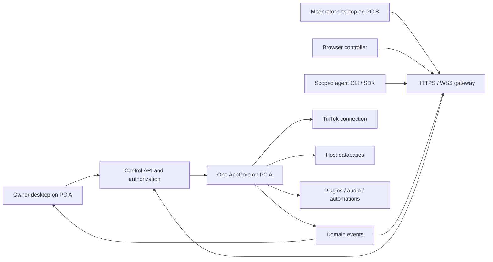

# Collaborative LIVE management

Status: full product design with an experimental host gateway, scoped reads and
durable workflow/event disable/delete, scoped points adjustments and disabled
automation drafts with trusted provenance.
Date: 2026-11-07. Last updated: 2026-11-08.

Implementation has started with trusted remote caller context, scoped
method policies, persistent invitations/device sessions/grants and typed
local-owner administration, plus the Cloud conflict-application fix.
The optional host-integrated HTTPS/WSS listener now supports approved native
and browser sessions, live grant/revocation checks, a minimal browser pairing
page and protocol negotiation. Authorized workflow subscriptions now support
immutable snapshots and retained replay. An isolated desktop controller now
supports profile pairing/selection, host status, scoped workflow views and
separate local drafts, explicit private saves and current-host conflict
comparison/local merge. Desktop and SDK/CLI can disable/delete explicitly permitted
workflows using revision-checked durable commands. The desktop syncs a native
intent before dispatch and resolves unknown outcomes without automatic replay;
see [desktop command recovery](LIVE-COLLABORATION-CLIENT-COMMANDS.md). Remote workflow definition saves,
activation, remaining domain writes and the complete same-app controller
workflow remain pending. Local **Settings → Collaboration** now provides TLS
configuration, private invitations/QR, device approval, grant editing, scoped
revocation and redacted history. See the
[owner settings guide](LIVE-COLLABORATION-OWNER.md) and
[the transport guide](LIVE-COLLABORATION-TRANSPORT.md) for the implemented
surface and setup. The local
Cloud backend was located at `/home/meme/Documentos/GitHub/RemakeBackend`.
Its Axum router (`crates/cloud-api/src/main.rs`), native PKCE handoff
(`desktop.rs`), account-scoped sync (`sync.rs`) and sync migration
(`migrations/20261102000003_sync.sql`) were inspected. They implement Cloud
accounts and `plugin-selections`, not LIVE rooms or remote command execution.
The direct-host design below requires no backend runtime/schema change; an
outbound Internet rendezvous/relay would be a separate backend implementation.
Cloud package-service moderator/admin roles do not grant LIVE authority.
Executed checks and remaining acceptance are tracked in
[the validation record](LIVE-COLLABORATION-VALIDATION.md).

The consistency foundation now includes transactional workflow revisions,
delete/recreate tombstones, atomic invalidation reservation and metadata-aware
local API/SDK reads and saves. Owner workflow commands now have durable results,
deduplication, host-instance fencing, seven-day result retention and scoped
outcome queries, including CLI metadata options. The host now drains workflow
outboxes into an idempotent audit index and a bounded projection-only event
channel; recovery republishes metadata without rerunning business actions.
Remaining domain ledgers, external-effect recovery, streams for other domains and
remote workflow save/activation authorization remain pending.

The [points implementation specification](LIVE-COLLABORATION-POINTS.md) now
tracks the next domain. Its writers share an ordered mutation boundary;
viewer revisions and invalidations commit with balances, including legacy
awards and resets. Scoped committed reads, additive remote `points.adjust` and
caller-owned outcome queries and points snapshot/replay are implemented. The
native points intent journal is implemented with a preserving format upgrade.
The desktop now displays bounded committed points, looks up permitted viewers
and confirms additive adjustments through that journal. Other domain UI and
physical two-PC/LIVE acceptance remain pending.

The [automation implementation specification](LIVE-COLLABORATION-AUTOMATION.md)
now records the actual executable behavior path, separately from stored workflow
graphs. Actions/events have transactional family-scoped revisions, atomic
reference cleanup and metadata-aware owner APIs. Runtime admission binds queued
steps to the matched definitions, so edits/disable/delete-recreate cancel their
unstarted effects. Single-record owner commands and remote whole-event
disable/delete now share durable results/IDs; remote status reads and recovery
expose closed summaries under family-qualified grants. The isolated native
controller now shows those summaries and confirms whole-event stop/delete through
its preserving version-4 journal. Host-owned provenance now retains delegated
identities across edits/deletion, and remote callers can durably submit explicitly
disabled drafts only under their own identity. The owner-only authority/adoption
API transfers a reviewed definition to owner authority while leaving it disabled;
enabling is separate. Runtime quarantine covers dependencies, manual/inline paths
and hotkeys. Owner source/dependency review and adoption now use a host-native
intent journal, including atomic reviewed dependency fences and original-outcome
recovery. A separate native JSON proposal editor now retains explicit private
author copies and submits disabled create/update commands through that shared
journal. An owner-only execution-manifest preview now binds saved definitions,
dependencies, provenance and current persisted author subjects without granting
execution. Private runtime context now survives queues, enrichment, nested emits
and remembered events; unsupported scoped work is denied before reads/effects.
Owner-only durable approval/activation/revocation and a first delegated policy
for saved log/delay/points actions are now implemented and locally tested;
see [the approval contract](LIVE-COLLABORATION-APPROVAL.md). The Owner approval
UI and native recovery coordinator are now implemented, including a shared
pending gate with adoption and native single-record definition changes. Scoped HTTP/audio effects, exact-topic emits and
bounded scripts now use current grant checks and durable non-replaying handoff
records. Emitted child rules retain every incoming subject and saved-definition
fence. Approved custom-topic rules accept only already-approved scoped input.
See the approval contract for current restrictions. Delegated plugins, HTTP
response emission and graph execution remain pending. The owner behavior
editor now pins base versions, retains conflicting drafts and requires explicit
comparison/rebase/recreation before a separate save. Owner create/update/delete
and enable/disable now use host-generated native intents and original-result
recovery; only the original fresh response can advance an editor from its saved
body. Recovery preserves newer text and never resends a mutation. Complete the remaining
execution gates before exposing broader remote activation or effects. Direct host
collaboration still requires no RemakeBackend runtime/schema change; an Internet
relay is a separate scope.

This document describes the product behavior and implementation roadmap.
[The protocol and acceptance specification](LIVE-COLLABORATION-SPEC.md) defines
the requirements for implementation. Existing Cloud Sync remains documented in
[CLOUD-SYNC.md](CLOUD-SYNC.md).

## Outcome

An owner runs a LIVE on PC A. A moderator opens the same TikTools application
on PC B, selects **Connect to another PC**, and joins PC A with an invitation.
Both see authoritative LIVE state and changes without pressing Sync. An agent
can use the same scoped control API through the CLI or Rust SDK.

PC A remains the execution host: it receives TikTok events, awards points,
evaluates automations, runs plugins, plays audio and owns persistence. PC B is
a controller. Its connection must never start another LIVE runtime, run a
second copy of an automation, or write to a second copy of the host database.

The initial product supports an owner and multiple independent controllers,
including a moderator and an agent at the same time. It is not an editor in
which two people manipulate the same workflow canvas simultaneously: saves
are revision checked, and conflicting drafts require an explicit choice.

## Current implementation and gaps

The following observations describe source inspected on 2026-11-08, not the
proposed remote behavior.

| Area | Existing implementation | Required extension |
| --- | --- | --- |
| Cloud Sync | Manual, account-scoped `plugin-selections`; only installed plugin activation is applied | Keep separate from LIVE collaboration |
| Control API | One registry over one `AppCore`; authenticated trusted caller context and deny-by-default read policies | Complete resource policies and command metadata |
| Events | Bounded workflow subscriptions, coherent snapshot pages, retained replay and permission-bound sequences | Other domain streams, scoped feed history and client recovery lifecycle |
| Browser | Separate opt-in HTTPS/WSS remote endpoint with minimal pairing page; local adapter stays separate | Serve the complete remote Vue controller and confined assets |
| Browser identity | Independent approved remote cookie sessions, Origin/CSRF checks and single-use WSS tickets | Complete browser controller lifecycle and recovery |
| Desktop | Separate native controller/bridge, scoped workflow/points views, durable commands, private confirmed draft saves and conflict comparison; owner settings | Full domain shell, desktop trust management and platform acceptance |
| Workflow save | Transactional revisions/CAS, durable owner commands, recoverable outbox delivery and audit indexing, including legacy local callers | External-effect recovery and delegated remote effect policy |
| Executable behavior | Atomic revisions, checked owner editor, native proposal/stop board, trusted provenance/adoption, exact manifests/contexts, durable core approval/revocation, Owner approval UI and native recovery, approved log/delay/points sinks | Plugin/settings bindings, broader effect policies, external-effect recovery and full domain acceptance |
| SDK/CLI | Typed direct/IPC/HTTPS-WSS backends, isolated desktop bridge, OS credential profiles, explicit remote selection and recoverable workflow event streams | All-domain completion and platform acceptance |
| Permissions | Local-owner administration, persistent scoped grants, remote reads and durable workflow disable/delete | Complete resource/event policies, other writes and delegated-effect enforcement |

Source references:

- [Control API routing](../crates/tiktools-control-api/src/lib.rs) and
  [typed SDK](../crates/tiktools-client/src/lib.rs).
- [Loopback browser adapter](../crates/tiktools-cli/src/web.rs) and
  [frontend transport selection](../src/web/app/main.ts).
- [Cloud coordinator](../crates/tiktools-cloud-sync/src/lib.rs) and
  [remote selection application](../crates/tiktools-core/src/control/cloud_sync.rs).
- [Workflow persistence](../crates/tiktools-core/src/db/sqlite/workflows.rs).
- [Desktop presentation contract](LIVE_WEBVIEW_PROJECTION.md) and
  [browser adapter validation](LOCAL_BROWSER_ADAPTER_VALIDATION.md).

The local review ran `cargo test -p tiktools-cloud-sync --locked`: 12 tests
passed against a mock server. This is evidence for current plugin-selection
sync, not for remote collaboration, production Cloud endpoints or two physical
PCs. Source inspection found that conflicted Cloud entries could be applied
locally before conflict resolution; the initial implementation now withholds
pending entries and adds regression assertions for explicit resolution.

## Architecture decision

Use one authoritative host with remote controllers. Reuse the existing
Control API and domain events; add identity, authorization and connection
management at that boundary. Do not replicate two executing `AppCore`s.

The remote gateway runs in the host process and holds the existing Control
API, never a second core. Keep the current IPC and local browser adapter
available. In particular, do not obtain remote access by changing the local
adapter's bind address and forwarding arbitrary methods as a trusted local
client: that would discard the remote caller's identity.

The host gateway supports LAN and reachable Internet HTTPS/WSS endpoints.
Internet access requires a routable endpoint or a configured TLS reverse
proxy/tunnel. Automatic NAT traversal, hosted relays and Cloud account discovery
are future extensions, not prerequisites or capabilities promised by this
release. Invitation creation must explain which configured address is usable.

## User journeys

### Owner enables collaboration

1. Open Settings → Collaboration on PC A.
2. Enable remote access and configure the advertised HTTPS address and TLS.
3. Select a profile and, where applicable, allowed plugins or workflows.
4. Create a short-lived invitation. Copy its join link or scan its QR code.
5. Approve the joining device after checking its displayed name and requested
   access. The device name is a label, not proof of identity.
6. See the controller online, its effective permissions and its last activity.

Enabling collaboration does not sign out Cloud, change plugin selections,
start a LIVE or open a public listener without explicit configuration.

### Moderator joins from the same desktop app

1. On PC B choose **Connect to another PC** before starting a local runtime.
2. Enter the invitation. Verify the host identity using the trust flow in the
   specification; do not silently accept an untrusted certificate.
3. Wait for host approval, then load the permitted state snapshot.
4. See a persistent **Controlling PC A** indicator and connection status.
5. Make allowed changes; see host-confirmed results and updates on both PCs.

When switching away from an already-running local workspace, explicitly stop
that local runtime first or open a separate controller window with a separate
transport and store scope. Never silently mix local and remote state. The
default full implementation uses a separate controller window.

### Browser joins

Serve the existing Vue app from the remote endpoint over HTTPS. Pair through
an HttpOnly session cookie and the same approval flow. Browser navigation and
hidden tabs affect only that browser's projection, not the owner's window.
Remote-only limitations are visible before an operation is attempted.

### Agent helps with the LIVE

The owner creates an agent invitation with an explicit capability and resource
allowlist. The agent connects using remote SDK/CLI transport and can discover
only its permitted operations. A normal agent cannot grant itself access,
install code, export secrets, shut down the host or access arbitrary files.
Permission to execute a plugin action includes the specific plugin/action;
permission to edit a workflow does not automatically grant every capability
that workflow could invoke.

### Connection drops or permissions change

Show reconnecting state immediately and stop sending new mutations. Keep
unsaved drafts on the controller. Reconnect, authenticate again, resolve any
unknown command outcomes and recover authoritative state before enabling
editing. Never automatically replay audio, point adjustments or plugin actions.
Removing a controller or disabling collaboration stops its access on the host;
the owner's LIVE continues.

## Initial access profiles

Profiles expand to explicit capabilities; the host checks capabilities and
resource restrictions for every call and every outgoing event.

| Profile | Default access |
| --- | --- |
| Owner | Existing trusted local desktop/IPC; manages collaboration and secrets |
| Viewer | Sanitized LIVE status, feed and permitted ranking/points reads |
| Moderator | Viewer plus scoped operational changes explicitly granted by owner |
| Agent | Owner-selected capabilities and resources; no implicit write access |

The moderator preset may include point adjustments, approved workflow
enable/disable and selected plugin actions. Saving automation definitions,
changing plugin settings and managing competitions require separate grants.
Host administration remains local-owner-only in version 1. A TikTok platform
moderator role does not automatically grant TikTools access, and this feature
does not itself add TikTok ban/mute/delete-chat APIs.

## Supported collaborative areas

| Area | Shared behavior | Execution location |
| --- | --- | --- |
| LIVE status and feed | Stream plus bounded read-only recovery | Host |
| Points and rankings | Authoritative totals and scoped commands | Host |
| Competitions | Read state and execute permitted transitions | Host |
| Workflows/automations | Revision-checked drafts, saves and enable/disable | Host |
| Plugin settings | Redacted reads, validated scoped changes | Host |
| Plugin actions and TTS | Explicit approved commands with deduplication | Host output devices |
| Overlays/widgets | Configure only through approved existing operations | Host/gateway |
| Controller preferences | Navigation, filters, draft text and layout | Controller only |

Any domain not fully adapted for permissions, recovery, revisions and command
outcomes stays unavailable remotely until its acceptance tests pass. Remote
file picking, code/package installation, credential import and native desktop
windows are unavailable in version 1. Remote media uses validated host asset
identifiers; controller filesystem paths are not host asset identifiers.

## Implementation roadmap

All phases below are required for the full version-1 release unless explicitly
marked optional. Each phase should be reviewable as a separate change.

| Phase | Deliverables | Exit evidence |
| --- | --- | --- |
| 0. Baseline | Capture API/topic inventory; fix Cloud conflict application; document executable writer paths and host-only effects | Regression for unresolved conflicts; every method/topic classified |
| 1. Identity and policy | Trusted request context, deny-by-default remote policies, principals, invitations, grants, redaction and audit | Forged identity, unknown method/topic and delegated-effect tests |
| 2. Consistency | Resource revisions, transactional command records/outbox, local-writer integration, unknown outcomes | Concurrent writer, duplicate command and crash recovery tests |
| 3. Remote gateway | Host-integrated HTTPS/WSS, multi-session pairing, TLS configuration, origin checks, bounds and revocation | Independent clients, authorization and network integration tests |
| 4. Recovery | Authorized subscriptions, coherent snapshot barriers, replay/gaps, backpressure and permission changes | Snapshot race, reconnect, restart and slow-client tests |
| 5. Same-app controller | Startup mode, remote native transport, scoped Vue stores, host identity, drafts and conflict UI | Two desktop instances controlling one host; zero local effects on controller |
| 6. Browser and agents | Remote browser deployment, confined plugin frames/assets, SDK/CLI remote mode and discovery parity | Browser acceptance and agent capability tests |
| 7. Domain completion | Points, rankings, competitions, workflows, plugin settings/actions, widgets and host-output behavior | Domain matrix complete with audit and revisions where required |
| 8. Release | Cross-platform two-PC runs, fault injection, load tests, operator guide and rollout switch | All normative acceptance criteria and evidence recorded |

## Intended code ownership

Locations include implemented foundations and remaining integration work.

| Location | Responsibility |
| --- | --- |
| `crates/tiktools-control-api/src/context.rs`, `policy.rs` | Principal context, method/topic policy, remote discovery filtering |
| `crates/tiktools-control-api/src/modules/collaboration.rs` | Typed session, invitation, grant and audit management DTOs/registration |
| `crates/tiktools-collaboration/` | Implemented identity/grant store, authorization views and shared command DTOs; domain command storage stays with business data |
| `crates/tiktools-core/src/lib.rs` | Lazy host ownership of the collaboration service |
| `crates/tiktools-core/src/db/` | Workflow revisions, transactional command/audit reservations and bounded recoverable metadata delivery; other domain migrations remain pending |
| `crates/tiktools-remote/` | Implemented optional HTTPS/WSS host gateway; native client lives in `tiktools-client/src/remote/` |
| `crates/tiktools-desktop/src/` | Controller startup/window mode, secure credential storage and host TLS lifecycle |
| `crates/tiktools-cli/src/` | Host configuration and remote connection options; no per-call shell proxy |
| `crates/tiktools-client/src/` | Typed collaboration methods, native remote backend, profile/keychain boundary and acknowledged recovery lifecycle |
| `src/web/shared/api/` | Remote handshake, transport lifecycle, revisions and recovery |
| `src/web/entities/collaboration/`, `src/web/features/collaboration/` | Session state, permissions, invites, controller and conflict UI |

The shared SDK must keep the registry/typed-client/validator parity invariant.
The optional remote networking implementation must not create a circular
dependency with the control API or a GUI dependency in core. Share protocol
types through the control API; expose the network client through an adapter
trait implemented by `tiktools-remote`.

## Rollout and operations

Remote access ships disabled. It can be disabled immediately without logging
out Cloud or stopping the LIVE. Version 1 requires a persistence-enabled host;
an unsupported build reports the missing capability before invitation creation.

Use an isolated `TIKTOOLS_HOME` for development and fixtures. Back up existing
databases before applying migrations. Schema changes are additive; disabling
the feature preserves existing local data. Downgrading binaries across schema
changes requires a supported migration path or restoring the backup, never
editing SQLite files while the host is running.

The release guide must cover TLS/trust setup, reachable address configuration,
Windows firewall setup, invitation expiry, revocation, an offline host, restoring
connectivity, unknown action outcomes and collecting redacted diagnostics.
Do not print invitation secrets, cookies, private keys or remote credentials
in ordinary diagnostics.

## Completion evidence

Track each acceptance ID in the specification with the tested commit, host and
controller OS/build, automated or manual procedure, result and artifact path.
Record failures and unavailable checks explicitly. A mock protocol test is not
a real two-PC LIVE test. Record actual LIVE validation separately from synthetic
event injection and do not claim platform moderation capabilities from app
management tests.
