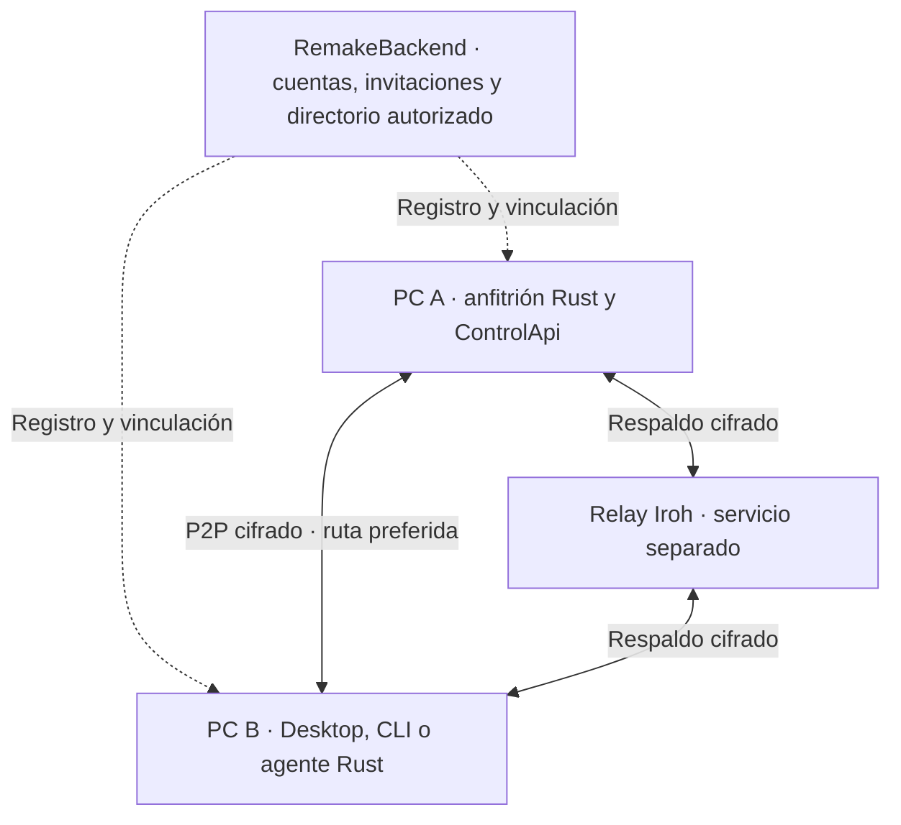

# Plan: colaboración Rust con WebRTC y señalización en el backend

## Decisión vigente: sustituir Iroh

Por instrucción del usuario, el transporte objetivo pasa a **WebRTC DataChannel**
en Rust, con negociación ICE mediante los WebSockets de **RemakeBackend**.
El backend se ejecutará en **Railway**. No se desplegará otro proceso,
contenedor o servicio de relay propio.
El código y las pruebas de Iroh descritos más abajo son evidencia de la
implementación anterior; no acreditan que esta migración esté terminada.

- La API existente autentica cuentas/dispositivos, conserva invitaciones y
  grants y transporta señalización SDP/ICE limitada a los equipos aprobados.
- WebSocket intercambia oferta/respuesta SDP y candidatos ICE; ese intercambio
  no obliga a que los datos de la sesión pasen por el backend.
- TURN estándar no se despliega en esta plataforma:
  la red pública de Railway expone HTTP/TCP y no proporciona las asignaciones
  UDP públicas necesarias para un TURN convencional. TURN sobre TCP describe
  el transporte hacia el servidor, no elimina por sí solo el tramo UDP relay.
  Se reutiliza el WSS existente para el respaldo cifrado de comandos. Ese
  relay de aplicación no es un servidor TURN.
- ICE intenta establecer la ruta directa; TURN puede aportar candidatos relay
  si finalmente se configura un proveedor compatible.
  Desktop y headless comparten el adaptador Rust. Se mantiene ControlApi,
  permisos locales, recibos y la vigencia offline por reloj de arranque.
- Las claves de dispositivo deben autenticar la negociación y vincular las
  huellas DTLS con las identidades aprobadas. Recibir SDP no otorga autoridad.
- Una conexión directa establecida sigue operando si el backend cae. Una
  sesión que depende del respaldo WSS deja de tener esa ruta cuando cae ese mismo
  backend; no se prometerá continuidad del relay en esa situación.
- Los puertos de STUN/TURN y las asignaciones relay se publican desde la
  infraestructura existente, no desde las PCs de los usuarios. El puerto HTTPS
  de Axum por sí solo no transporta el protocolo TURN.

Orden de migración: implementar señalización WSS autorizada, resolver el
respaldo compatible con Railway, sustituir el adaptador Iroh por un DataChannel
fiable/acotado, reconectar Desktop/CLI, repetir el laboratorio real con ruta
directa y respaldo forzado, y retirar los artefactos del relay anterior.
La validación de puertos públicos depende de la plataforma donde se ejecuta el
backend; una plataforma que solo expone HTTP no basta para el despliegue TURN.

Referencias de integración: [WebRTC Rust](https://github.com/webrtc-rs/webrtc),
[TURN como biblioteca embebible](https://docs.rs/turn/latest/turn/server/config/struct.ServerConfig.html).
Restricciones verificadas: [red pública de Railway](https://docs.railway.com/networking/public-networking/specs-and-limits)
y [proxy TCP](https://docs.railway.com/networking/tcp-proxy).

### Señalización WSS implementada en RemakeBackend

El socket existente `/api/v3/remote/socket` admite ahora `rtc.signal` después
de su autenticación normal por ticket firmado de dispositivo. El descubrimiento
de capacidades anuncia `remoteControl.rtcSignaling`, incluido el endpoint de
configuración ICE. No anuncia un servidor TURN.

El controlador inicia con una oferta; el anfitrión responde. Ambos pueden
enviar candidatos ICE y fin de candidatos. Cada mensaje lleva `negotiationId`,
`sessionId`, `hostDeviceId`, una secuencia propia por emisor, `signal` y
`signature`. El backend añade la identidad real del emisor y su clave pública;
el cliente no puede elegir esos campos.

La firma Ed25519 cubre `hostId`, `sessionId`, `hostDeviceId`, `fromDeviceId`,
`negotiationId`, `grantRevision`, `sequence` y `signal`, en JSON canónico tras
el dominio `tiktools.webrtc.signal.v1` seguido de un byte NUL. Los opcionales
de candidato se serializan explícitamente como null cuando no están presentes.
Se usa la clave de endpoint ya registrada por doble prueba de posesión, no una
clave arbitraria incluida en el mensaje recibido.

Cada mensaje revalida dispositivo, equipo, sesión, revisión confirmada y la
encarnación vigente del socket en la base de datos. Un intento dura 60 segundos,
con hasta cuatro intentos simultáneos por sesión y 65 mensajes por emisor.
SDP admite hasta 64 KiB y un candidato hasta 2048 bytes. El SDP incluye su
huella DTLS y queda cubierto por la firma; el anfitrión todavía debe validar la
negociación y aplicar los permisos al canal resultante.

La tabla nueva guarda claves, contadores y vencimiento, sin SDP ni candidatos.
La entrega entre nodos reutiliza la cola temporal existente, que sí puede
contener esos mensajes durante su entrega; no se registran como comandos ni
como recibos de negocio. La cola mantiene el orden por ID dentro de cada lote.
Desktop/CLI ya utilizan DataChannel en los builds Cloud. El respaldo compatible
con Railway integra el túnel cifrado con el enrutamiento WSS existente; su
implementación y evidencia se detallan en las secciones siguientes.

La suite v3 pasa sus 26 pruebas contra PostgreSQL aislado. Incluye oferta,
respuesta y candidatos por WebSockets reales, también entre dos nodos del
backend, rechazo de claves incorrectas y sesiones ajenas, secuencias repetidas,
expiración, límites y sockets cuya encarnación ya fue reemplazada. La
señalización no crea comandos de negocio. La suite incluye también la conexión
WebRTC nativa; no acredita conectividad entre dos redes físicas.

### Adaptador WebRTC Rust: validación inicial

`crates/tiktools-rtc` implementa un DataChannel fiable y ordenado, con
fragmentación de mensajes de hasta 1 MiB, paquetes de hasta 16 KiB y colas
acotadas. No incorpora proveedores STUN/TURN públicos implícitos. La negociación
sin canal abierto vence a los 60 segundos; cerrar o descartar el propietario
cancela sus tareas. Cancelar una recepción conserva el estado parcial; cancelar
un envío parcial impide reiniciarlo en ese mismo stream.

El módulo de señalización firma y verifica el mismo JSON canónico Ed25519 que
RemakeBackend, exige contexto y clave previamente fijados y rechaza repeticiones,
revisiones distintas, cambios de SDP y señales fuera de orden o vencidas.
El vencimiento local usa tiempo transcurrido; `expiresAt` remitido por el backend
no sustituye la autenticación criptográfica ni es parte de esa firma.

Las pruebas conectan dos peers WebRTC Rust por loopback e intercambian SDP/ICE,
DTLS y SCTP reales, incluyendo un mensaje de 1 MiB y recepción cancelada.
La validación inicial pasó 13 pruebas, Clippy estricto y compilación con el
Rust mínimo del proyecto (1.95); la evidencia ampliada aparece más abajo.
El módulo `cloud_socket` admite el socket WSS existente con ticket de un solo
uso, valida el equipo/rol/sesión/revisión del mensaje inicial, mantiene heartbeat
y limita tramas a 128 KiB. Los tickets viajan en el primer mensaje, nunca en la
URL. La URL requiere HTTPS salvo IP de loopback explícita. Un envío firmado
cancelado o fallido no se reintenta silenciosamente en la misma conexión.
El laboratorio nativo pasa contra RemakeBackend y PostgreSQL aislados: tickets
reales, negociación SDP/ICE firmada y verificada por el backend, y DataChannel
entre dos peers Rust. Tras cerrar ambos sockets WSS, un mensaje de más de
400 KiB sigue llegando por el canal directo. La prueba ampliada incorpora
ahora el coordinador Cloud nativo y RPC reales sobre WebRTC, además del flujo
anterior de alta y aprobación. Usa una sola máquina y un backend por loopback,
con una CA temporal confiada solo por el proceso de aceptación; no desactiva
TLS ni usa cuentas reales.
Clippy estricto del adaptador y de la prueba integrada también pasa.
El módulo de negociación produce `AuthenticatedChannel` únicamente después de
verificar la señalización con la clave fijada y establecer DTLS. `RtcGateway`
admite ese canal en el motor ControlApi compartido; selecciona la autorización
local por clave, origen/cuenta/equipo Cloud, dispositivo y revisión exacta.
`RemoteClient::connect_rtc` usa la misma negociación RPC, límites, recibos y
heartbeat que los otros transportes, sin credenciales bearer.
La prueba `tests/rtc.rs` ejecuta comandos de puntos con deduplicación, recibos,
escopes por espectador, heartbeat y revocación. También rechaza un canal firmado
por una clave sin permiso y una revisión distinta de la importada.
La suite de colaboración pasa 79 pruebas y la del adaptador 13. La prueba
integrada de RPC WebRTC pasa con las funciones Cloud/native activas y Clippy
estricto de ambos adaptadores. El gateway no genera una clave de reemplazo si
falta la identidad registrada; también se comprueba que detenerlo cancela la
admisión de un canal que todavía no ha enviado su bootstrap RPC.
`CloudRtcHost` integra ahora publicación, confirmación/refresco de permisos,
recepción de ofertas y admisión al gateway. Mantiene separados el WSS de
señalización, los intentos de conexión y los RPC activos; una desconexión de
Cloud cancela solo las negociaciones pendientes. Los cambios de cuenta,
equipo, configuración o apagado cancelan el anfitrión y sus sesiones. Las
colas y los intentos simultáneos están acotados. Una política desconocida queda
sin confirmar y no bloquea a otros dispositivos compatibles.

El laboratorio ampliado pasa en 73,40 segundos. El nuevo anfitrión recibe por
WSS ofertas firmadas reales y ejecuta puntos/recibos mediante el DataChannel.
La entrada HTTPS/WSS del fixture se cierra, incluidas sus conexiones existentes,
y una petición HTTP confirma que Cloud no es accesible desde la app. Durante
22 segundos siguen funcionando ajustes deduplicados, lecturas y recibos,
cruzando tanto el heartbeat RPC como el período de refresco de metadatos.
Después se restaura esa misma entrada; vuelve la señalización y la revocación
Cloud cierra el RPC. También se prueba cerrar la cuenta y mantener sin confirmar
una política incompatible. PostgreSQL y el backend siguen vivos detrás de esa
entrada cerrada: la prueba acredita indisponibilidad de Cloud para la app,
no una caída real del proceso ni una conexión entre dos redes distintas.
Clippy estricto pasa en la app y en el backend con el fixture de aceptación.

El supervisor habitual de los builds Cloud de Desktop/CLI inicia ahora
`CloudRtcHost`; el SDK Cloud crea y abre DataChannels mediante señalización
firmada. Los perfiles nuevos son versión 3: fijan equipo/dispositivo/clave,
sin almacenar SDP, candidatos, IPs o relays. Un perfil versión 2 solo se migra
tras comprobar la misma clave e identidad RPC; conserva profile ID, principal,
sesión y la vinculación del diario de comandos. La reapertura WebRTC se cancela
con el solicitante, y un cambio de cuenta cancela negociaciones y publicaciones
pendientes. Una caída de Cloud no cancela un RPC directo ya establecido.

El directorio del backend usa el dispositivo de la concesión WSS vigente, además
del token de fencing, y no presenta una identidad nueva sobre una conexión vieja
durante rotación. Requiere la migración
`20261112000003_relay_device_binding.sql`. Las pruebas cubren esa transición
también entre dos nodos.

`python3 scripts/collaboration-cloud-lab.py --backend-suite` pasa las 26 pruebas
v3, incluida la aceptación nativa con supervisor/SDK habituales, migración de
perfil, reapertura, 22 segundos sin entrada Cloud y revocación. También pasan
las 167 pruebas unitarias del cliente (ocho fixtures ignorados), las 29 del
adaptador, Clippy estricto y compilación de Desktop y CLI, incluyendo CLI con
`remote-control`. La ruta que se muestra procede del par elegido por el
transporte ICE; no se infiere solo de que el DataChannel esté abierto.

### Descubrimiento STUN y base cifrada del respaldo

El operador configura `RTC_STUN_URLS` en el backend: una lista opcional de hasta
ocho URLs `stun:`, sin credenciales ni proveedor público implícito. El endpoint
autenticado `/api/v3/remote/rtc-config` la entrega al SDK y al anfitrión; este
último vuelve a consultarla al reconectar la señalización. No se guardan estas
direcciones en perfiles ni se rompe el contrato anterior de `/peer-config`.
Una prueba UDP real verifica que el adaptador obtiene un candidato `srflx` de
un servidor STUN local. Eso no sustituye una prueba NAT entre dos PCs.

`tiktools-rtc::relay` implementa la capa TLS 1.3 mutua del respaldo WSS.
Cada intento crea una CA y un certificado temporales en memoria. La clave de
dispositivo firma la CA junto con equipo, sesión, dispositivos, intento y revisión
exacta del grant. Solo se confía en la CA verificada con la clave previamente
aprobada; se mantiene la validación normal de TLS, sin instalar certificados en
el sistema ni aceptar certificados arbitrarios. No se usan tickets de reanudación
ni datos tempranos. La negociación vence por tiempo transcurrido.

Las catorce pruebas del respaldo cubren TLS real a través de un relay opaco,
rechazo de suplantación y cambios de contexto, vencimiento, mensajes de hasta
1 MiB, controles, recepción cancelada y envío parcial cancelado que impide
retransmitir un comando incierto. El puente nativo también transporta una trama de
1 MiB mediante registros acotados y valida contexto, secuencia y cierre ordenado.
El SDK y el supervisor Cloud de Desktop/CLI ya conectan ese puente con el mismo
motor de permisos, RPC y recibos que WebRTC. Al abrir una conexión se intenta
ICE directo durante ocho segundos; si no conecta, se inicia una nueva negociación
de túnel WSS. No se activa el respaldo ante una firma/contexto inválidos ni se
reenvía un RPC incierto. El perfil conserva la misma identidad local del host,
principal y sesión. Una conexión activa que se pierde se cierra; el coordinador
Desktop reabre el perfil con backoff y recupera sus proyecciones y recibos. El
SDK y el CLI de una sola operación pueden reabrirlo explícitamente. Ninguno de
estos recorridos vuelve a enviar comandos inciertos.

`RTC_RELAY_ONLY=true` permite al operador rechazar la señalización directa y
comprobar el respaldo sin cambiar las PCs. El laboratorio ejecuta tanto ese
recorrido como el directo con el SDK y supervisor habituales: confirma cambios,
duplicados, restricciones, migración de perfiles, recuperación tras caída de
Cloud y revocación. El recorrido directo sigue operando sin Cloud; el relay se
interrumpe y recupera sus recibos al reabrir. Una prueba adicional comprueba el
plazo real de ocho segundos sin respuesta ICE y otra rechaza SDP falsificado
sin intentar el relay.

La aceptación del relay incluye ahora el coordinador Desktop real: después de
cortar Cloud, vuelve a `ready` con otra conexión y los mismos host, principal y
sesión. El backend diferencia al anfitrión temporalmente desconectado de una
revocación; el coordinador reintenta solo la indisponibilidad y conserva las
validaciones de permisos, revisión y fencing. `tiktools --json remote check
moderator` ofrece una comprobación de solo lectura con ruta y tiempo de conexión,
sin direcciones, credenciales ni políticas. El adaptador también supera la
compilación cruzada para Windows GNU; eso no acredita ejecución en Windows.

La prueba nativa también cubre respuesta perdida después del commit. El proxy
privado retiene solo los bytes de respuesta hacia controladores, identificados
por su `ready` externo. El propietario lee un recibo durable exitoso mientras el
diario Desktop sigue pendiente; se corta Cloud antes de entregar la respuesta.
Al reconectar, el diario confirma ese mismo ID mediante su recibo y el total de
puntos no vuelve a cambiar. No se descifra el RPC ni se añaden hooks al host o
al backend de producción. Los cambios de modo del proxy se publican de forma
atómica para evitar desconexiones falsas durante la propia prueba.

Las peticiones del protocolo Cloud anterior reciben `unsupportedOperation`
del anfitrión nativo, sin ejecutarse ni cerrar su WSS compartido. La prueba del
socket verifica el rechazo y que el siguiente evento siga llegando; un cliente
controlador no puede enviar respuestas de anfitrión. Para gestionar el host se
usa el perfil nativo de Desktop/CLI y su motor de permisos habitual.

### Enrutamiento del respaldo en el backend existente

La migración `20261112000004_native_relay_tunnels.sql` añade metadatos de túneles
y una secuencia de fencing que no se reinicia al borrar una concesión WSS. El
socket existente admite `relay.open`, `relay.data` y `relay.close`. La apertura
lleva el anuncio de CA firmado; la firma cubre los campos escalares del contexto
y `certificate` en JSON canónico tras el dominio `tiktools.relay.tls.v1` y NUL.
El backend comprueba la clave de endpoint registrada. Las PCs siguen siendo
responsables de validar el certificado TLS y seleccionar el grant local.

Cada registro vuelve a comprobar sesión, dispositivo, revisión confirmada y las
dos generaciones WSS fijadas al abrir el túnel. Una conexión nueva no hereda
datos de la anterior. Cada sentido lleva su contador, sin huecos ni repeticiones.
Se admiten dos túneles por sesión, 60 segundos para responder la apertura y
hasta ocho horas desde su creación después de responder. Los registros opacos
admiten hasta 16 KiB; hay límites de 30 aperturas y 6000 registros por minuto y
dispositivo. El encolado de túneles rechaza destinos con 64 mensajes pendientes;
las escrituras se serializan bajo bloqueo, incluso con envíos concurrentes.

El enrutamiento comparte la entrada HTTPS/WSS, las concesiones y la cola temporal
del backend; no añade un servicio. Los metadatos duraderos no guardan certificados,
cifrado ni comandos. La cola temporal sí puede contener anuncios públicos y
registros TLS durante su entrega. La aceptación del transporte no es un recibo
de negocio. Las pruebas de WebSockets reales cubren ambos sentidos entre dos
nodos, permisos, orden, expiración, revocación, límites y cambio de generación.
Otras dos pruebas verifican el rechazo de entregas de generaciones viejas y el
cierre de consumidores lentos en vez de continuar tras perder un registro.

Faltan la prueba entre dos redes/PCs y la aceptación con un LIVE real.
Los artefactos antiguos de Iroh siguen conservados durante la migración y no
forman parte del despliegue WebRTC actual.

## Implementación anterior y evidencia conservada

Estado: implementación en curso, 2026-11-12. El alcance completo sigue pendiente;
la evidencia parcial se detalla al final. El laboratorio HTTPS sigue descrito en
[la aceptación de dos PCs](TWO-PC-ACCEPTANCE.md).

## Objetivo y decisión propuesta

Una PC anfitriona ejecuta TikTok, automatizaciones, plugins y efectos. Desktop,
CLI y agentes headless de otros equipos controlan ese mismo anfitrión. La app
elige automáticamente la ruta disponible y muestra `Directa`, `Relay` o
`Reconectando`. El usuario inicia sesión, invita y aprueba; no configura IPs,
certificados o puertos de entrada en las PCs.

El alta desde la interfaz usa exclusivamente el backend: cuenta Cloud, equipos,
invitaciones y aprobación. Se elimina `directSetup`, su formulario HTTPS manual
y el composable de emparejamiento asociado. Los perfiles guardados siguen
permitiendo reconectar una sesión previamente autorizada. Esto no obliga a
enviar cada comando por el backend: la ruta de datos sigue siendo directa o relay.

La implementación anterior eligió **Iroh** como transporte para clientes nativos;
esta decisión queda sustituida por WebRTC en la sección vigente de arriba.
Expone conexiones QUIC autenticadas por identidad criptográfica, conectividad
directa y relay de respaldo. Puede iniciar una conexión por relay y migrarla a
directa: preferir P2P significa usar la ruta directa cuando sea viable, sin
retrasar innecesariamente la conexión inicial esperando que atraviese el NAT.
TLS permanece interno al transporte; se elimina su configuración manual por PC.
[Contrato de Iroh](https://docs.rs/iroh/1.4.1/iroh/).

La restricción inicial de no añadir WebRTC ya no aplica. Las pruebas anteriores
de compatibilidad con Rust 1.95 y Tokio deben repetirse con las dependencias RTC.

### Alternativas revisadas

La investigación no cambia todavía el transporte implementado:

| Alternativa | Encaje y coste de integración estimado |
| --- | --- |
| [rust-libp2p](https://libp2p.github.io/rust-libp2p/dcutr_example/index.html) | Rust y headless, relay y mejora a conexión directa mediante DCUtR. Es la alternativa más cercana; requiere ensamblar y operar más componentes de conectividad. |
| [webrtc-rs](https://github.com/webrtc-rs/webrtc) | Canales de datos Rust y compatibilidad con navegador. Requiere señalización SDP/ICE mediante nuestro backend y STUN/TURN para conectividad y respaldo; véase la [documentación WebRTC](https://webrtc.org/getting-started/peer-connections). |
| [Quinn](https://github.com/quinn-rs/quinn) | QUIC en Rust. Es una base de transporte; habría que añadir descubrimiento, NAT traversal y relay para cubrir este plan. |

Para comparar una sustitución nativa, priorizar una prueba acotada de libp2p.
Si el requisito principal pasa a ser P2P desde navegador, evaluar WebRTC.
Estas prioridades son una evaluación de arquitectura, no resultados de rendimiento.
En cualquier opción se conserva el backend como autoridad de alta y aprobación,
y el anfitrión como autoridad de ejecución. Cambiar Iroh exige sustituir también
el adaptador, los metadatos de endpoints y el servicio de relay; los permisos,
recibos y métodos de ControlApi se mantienen.

## Arquitectura



- **RemakeBackend:** autenticación Cloud, dispositivos, invitaciones,
  aprobación, asociación entre dispositivo y clave de transporte, descubrimiento
  limitado a equipos autorizados y configuración del relay.
- **Anfitrión:** autoridad sobre permisos efectivos, sesión local, ejecución,
  revisiones, recibos de comandos y publicación de cambios.
- **Controlador Rust:** una sesión remota compartida por Desktop, CLI y agentes;
  nunca inicia otro `AppCore` para ejecutar las órdenes del anfitrión.
- **Relay:** transporta tráfico cifrado cuando la ruta directa no es viable.
  El servicio puede desplegarse junto al backend, con ciclo de vida independiente.

El relay WSS actual de RemakeBackend **no es compatible** con el protocolo de
Iroh. Reutilizaremos su administración de dispositivos/equipos y sus pruebas de
permisos; no presentaremos su socket existente como un relay Iroh.
La propuesta es desplegar `iroh-relay` como servicio auxiliar, con límites,
autenticación/admisión adecuados a la versión elegida y métricas. El certificado
público se administra en la infraestructura, no en cada PC.
[Servicio de relay](https://docs.rs/iroh-relay/1.4.1/iroh_relay/).

Para simplificar la primera entrega habrá un solo canal de datos nuevo:
Iroh directo o Iroh por relay. El WSS legado se conserva como ruta existente;
no se añade una tercera conmutación automática WSS/Iroh. La UI nativa usa su
puente Rust. El controlador de navegador queda en su transporte actual.

## Reutilizar el contrato de colaboración

Conservar los métodos de `ControlApi`, sobres JSON-RPC, metadatos, límites,
permisos por recurso, revisiones y comandos durables existentes. El adaptador
de transporte entrega peticiones con una identidad remota autenticada; nunca
las convierte en llamadas IPC de Owner.

Primero conectar una identidad Cloud aprobada con un principal/sesión local
persistente de `CollaborationService`. Guardar el vínculo explícito entre
cuenta, host, dispositivo, clave Iroh y revisión del permiso. Demostrar posesión
de esa clave y vincular la negociación a la identidad del anfitrión y a un reto
fresco. Una clave de transporte conocida por sí sola no otorga permisos.
No reutilizar secretos Cloud como claves de transporte ni confiar en un ID
de dispositivo declarado en el JSON.

La autorización de comandos y efectos sigue viviendo en el anfitrión. Cloud
coordina la vinculación y comunica cambios de acceso, pero una consulta HTTP
a Cloud por cada comando impediría cumplir el requisito de continuidad offline.
El `admit` actual de `cloud_remote_host.rs` consulta permisos Cloud: deberá
reemplazarse por la admisión local común para la nueva sesión de colaboración.

### Protocolo inicial acotado

- Un endpoint Iroh por proceso y un identificador de protocolo versionado,
  por ejemplo `tiktools/collaboration/1`.
- Un flujo fiable bidireccional de control con mensajes delimitados por longitud
  y un máximo negociado. Reutilizar las colas y límites actuales, sin colas
  ilimitadas, transferencias de medios ni nuevos formatos de negocio.
- Negociación de identidad y `collaboration.hello` antes de exponer métodos.
- Reutilizar subscribe/snapshot/resume y sus cursores/revisiones. Ante un hueco,
  limpiar la proyección afectada y recuperar una base; no mostrar éxito ficticio.
- Evitar reenvíos especulativos y 0-RTT para mutaciones. Mantener IDs de comando
  y consultar el recibo del anfitrión ante un resultado ambiguo. Un acuse del
  relay solo confirma transporte, no ejecución de negocio.
- Un cambio de ruta no crea una segunda identidad ni despacha dos veces.
  Si hay que abrir una nueva conexión, cercar la conexión anterior y recuperar
  la sesión antes de habilitar cambios. Mantener la identidad lógica separada
  de los IDs de conexión usados actualmente por los formularios.

## Qué significa seguir funcionando si Cloud cae

| Situación | Comportamiento requerido |
| --- | --- |
| P2P ya establecido; cae la API Cloud | Continúan comandos y cambios bajo la sesión y permisos locales vigentes. |
| P2P ya establecido; caen API y relay | Continúa mientras la ruta directa siga siendo alcanzable y la autorización siga vigente. |
| Se pierde la ruta directa; relay disponible | Intentar conmutación/recuperación mediante relay, sin repetir mutaciones ambiguas. |
| Ruta directa inviable; relay y API caídos | No prometer conectividad; mostrar desconexión. El anfitrión sigue ejecutando su live local. |
| Reinicio o cambio de red sin Cloud | Intentar direcciones conocidas y autorización local vigente; la reconexión no está garantizada. |
| Nuevo equipo sin vinculación previa; Cloud caído | No crear aprobación Cloud nueva. Vinculación totalmente offline queda fuera del primer alcance. |
| El Owner revoca desde el anfitrión | Denegación inmediata local para comandos y efectos posteriores. |
| Se revoca en Cloud durante una interrupción | El anfitrión aplica la revocación al recibirla; no puede conocerla instantáneamente mientras está aislado. |

La sesión offline se limita a **8 horas desde la última validación de
autorización**, sin extensión automática durante una caída. El anfitrión aplica
el límite tanto a peticiones como a sujetos de automatización guardados. El
deadline persistido usa identidad de arranque y tiempo transcurrido que incluye
suspensión, separado de los timestamps informativos de calendario. Cambiar la
hora no extiende ni acorta ese intervalo.

Reiniciar la app conserva la vigencia dentro del mismo arranque. Reiniciar el
sistema requiere validación Cloud nueva: no se confía en la hora ajustable para
calcular cuánto estuvo apagado. En Windows también se requiere revalidar si se
descarga la sesión/hive del usuario que contiene el marcador volátil. Si el SO
no proporciona el reloj/identidad necesarios, o falta evidencia en un registro
antiguo, se deniega hasta una validación nueva; nunca se crea una identidad
remota sustituta.

Linux usa [CLOCK_BOOTTIME](https://man7.org/linux/man-pages/man2/clock_gettime.2.html)
y el boot ID del kernel. macOS usa el [contador continuo de Mach](https://github.com/apple/darwin-xnu/blob/main/osfmk/mach/mach_time.h)
y `kern.bootsessionuuid`. Windows usa [GetTickCount64](https://learn.microsoft.com/windows/win32/sysinfo/windows-time)
y un marcador propio en una [clave volátil](https://learn.microsoft.com/en-us/windows/win32/api/winreg/nf-winreg-regcreatekeyexw)
por usuario, sin privilegios de administrador. El cliente P2P deja la caducidad
al anfitrión y no compara relojes de distintas PCs ni congela la fecha recibida
al conectar; los clientes HTTPS conservan la caducidad de sus credenciales.

Al volver Cloud se revalidan permisos antes de renovar. Una revocación conocida
no se revierte por una respuesta antigua o por una renovación de transporte.

La UI debe explicar esa ventana. No se puede ofrecer a la vez independencia
total de Cloud y conocimiento inmediato de revocaciones hechas solo en Cloud.

## Implementación por entregas

### 1. Prueba Rust de conectividad y decisión de dependencia

En una pequeña prueba headless con dos procesos y un relay propio:

1. Fijar versión candidata y comprobar MSRV, plataformas, licencia y dependencias.
2. Intercambiar mensajes acotados, autenticar las claves y observar la ruta real.
3. Probar LAN directa, redes distintas y UDP bloqueado.
4. Apagar API y relay después de verificar ruta directa; el intercambio continúa.
5. Forzar relay, cortar/reponer la ruta y verificar recuperación.

**Salida:** evidencia medible de P2P/relay y de qué conexiones sobreviven a
cada caída. No continuar con UI hasta que esta prueba sea viable. Validar la
autorización del relay y su protección contra uso ajeno, no asumir que desplegar
un relay público ya aplica las cuentas de TikTools.

### 2. Una identidad y un motor de permisos

En la app, implementar el vínculo Cloud → colaboración local y la prueba de
posesión de clave, aprobación, revisión de permisos, revocación y vigencia
offline. En RemakeBackend, añadir únicamente los datos/endpoints necesarios
para publicar la identidad de transporte y resolver equipos autorizados,
reutilizando dispositivos/equipos/invitaciones existentes.

**Salida:** un controlador aprobado puede consultar al anfitrión; una clave,
cuenta o grant diferente no puede asumir su identidad. Los permisos se
verifican sin una llamada Cloud por operación.

### 3. Primer recorrido completo headless

Extraer la separación mínima entre transporte y sesión del cliente actual;
añadir un adaptador Iroh host/cliente compartido. Si hace falta, crear un crate
pequeño `tiktools-peer` sin GUI ni construcción de `AppCore`.

Empezar con `hello`, estado del live, lectura de puntos, ajuste de puntos y
consulta de su recibo; todos pasan por `ControlApi` y los permisos existentes.
Añadir suscripciones con recuperación. Mantener un único anfitrión ejecutor.

**Salida:** dos procesos CLI/agent consultan y modifican el mismo host por
P2P o relay. El mismo command ID no duplica un ajuste después de perder una
respuesta o cambiar de ruta. No extrapolar esa propiedad a efectos externos
con resultado desconocido.

### 4. Desktop y automatizaciones existentes

Usar la misma sesión Rust desde la ventana del controlador. Extender a los
métodos de automatización ya permitidos, respetando delegación reutilizable,
grants de efectos, revisiones y cuarentena de propuestas cuando corresponda.
No crear una API paralela ni ampliar permisos como efecto de añadir P2P.

Flujo visible: iniciar sesión → elegir equipo → solicitar acceso → aprobar →
gestionar. Mostrar ruta y conexión en un único indicador; dirección, certificado
y relay pertenecen a diagnósticos/configuración de infraestructura.

**Salida:** el mismo comportamiento en Desktop y headless, con invalidación de
formularios obsoletos y recuperación del resultado de los comandos.

### 5. Despliegue de respaldo y observabilidad

Añadir a RemakeBackend configuración de descubrimiento/relay y una definición
de despliegue para el servicio auxiliar. Configurar TLS y los servicios de red
requeridos por la versión seleccionada de Iroh en infraestructura. Separar
reinicios del API de los del relay. No depender silenciosamente de relays o
directorios públicos del proveedor: configurar explícitamente los propios.

Registrar ruta utilizada, tiempo hasta conexión, cambios de ruta, bytes directos
y relayed, recuperación y errores; nunca secretos ni contenidos privados.
Aplicar límites de conexiones, frames, ritmo y presupuesto de relay. P2P reduce
tráfico de negocio en backend, pero descubrimiento, keepalives y respaldo siguen
consumiendo recursos. La mejora se mide antes de anunciar porcentajes.

### 6. Aceptación física y LIVE

Completar esta matriz con dos PCs, además de las pruebas automatizadas:

| Prueba | Resultado exigido |
| --- | --- |
| Dos PCs en LAN | Ruta directa comprobada y cambios visibles en ambas. |
| Redes diferentes/CGNAT | Directa si es viable; respaldo si no lo es. |
| UDP bloqueado | Operación por relay dentro de los límites soportados. |
| API caída con conexión directa | Continúa hasta la vigencia autorizada, sin consultas Cloud por comando. |
| API y relay caídos con conexión directa | Continúa si la ruta directa sigue viva. |
| Cambio de ruta con comando en curso | Resultado recuperable, sin duplicar el cambio. |
| Dos moderadores editando | Conflicto explícito o actualización por revisión. |
| Revocación/expiración | Se detienen comandos y efectos posteriores según la política acordada. |
| Reinicio del host | Cambio de instancia y recuperación válida, sin ejecutar órdenes antiguas. |
| LIVE real | Efectos autorizados solo en PC A; PC B no conecta otro runtime TikTok. |

Usar los componentes ya probados como base, pero no contabilizar las pruebas
HTTPS actuales como aceptación del nuevo transporte. La entrega queda lista
cuando pasan P2P, relay, conmutación, caída de Cloud y LIVE real en las dos PCs.

## Alcance para mantenerlo simple

- Primera entrega: Desktop nativo, CLI y agentes Rust; navegador sigue aparte.
- Un solo host autoritativo por live, sin replicar y ejecutar dos motores.
- Un transporte nativo nuevo con rutas directa/relay, un protocolo de negocio
  y un motor de autorización.
- Sin sincronización colaborativa de texto carácter a carácter, streaming de
  audio/video, transferencias de plugins o encadenamiento de relays en el MVP.
- Conservar el gateway HTTPS actual para compatibilidad y diagnóstico mientras
  se valida la alternativa; retirarlo requeriría una decisión posterior.

Primer paso recomendado: **entrega 1**, seguida del vínculo de identidad y el
recorrido completo de puntos headless. Eso demuestra la arquitectura antes de
extenderla al resto de pantallas y efectos.

## Evidencia actual y trabajo pendiente

La base Rust está implementada con Iroh 1.4.1 fijado, sin descubrimiento ni
relays públicos implícitos. Sus nueve pruebas cubren identidad persistente,
framing cancelable y acotado, límites de streams QUIC, conexión directa,
relay forzado y continuidad de una conexión directa tras apagar el relay de
prueba. La compilación del crate con Rust 1.95 pasó.

El gateway nativo y el cliente reutilizan la sesión RPC existente. La prueba
de integración P2P verifica ajuste de puntos, command ID sin duplicación,
recibo, restricciones por espectador, heartbeat sin consultas Cloud, revocación
local, perfil persistente sin bearer y reconexión con la misma identidad.
Esto es evidencia automatizada local; no acredita dos PCs físicas.

RemakeBackend dispone de directorio autorizado, publicación firmada con ambas
claves, revisión CAS, retos de un uso y confirmación HTTP firmada de grants.
El servicio `cloud-peer-relay` consulta esa autoridad para admitir conexiones;
también revalida y expulsa conexiones revocadas. Las 18 pruebas de regresión v3
pasaron, incluida una conexión cifrada con transporte IP deshabilitado a través
de ese código de admisión y monitor. El relay tiene definición de contenedor,
Compose independiente, métricas, límites y cierre SIGTERM; sus instrucciones
están en `RemakeBackend/deploy/PEER-RELAY.md`.

Se añadió el coordinador nativo del anfitrión, detrás de `cloud-peer`: publica
la identidad, recupera la revisión de publicación, confirma permisos aprobados,
importa únicamente revisiones confirmadas y consulta una vista completa de
autorizaciones. No usa la caducidad del directorio como revocación. Las 72
pruebas de colaboración incluyen cambios de revisión, suspensión por cuenta,
historial de grants y revocación definitiva. El cierre de sesión del anfitrión
suspende sus autorizaciones Cloud; las respuestas anteriores se cercan por la
sesión de cuenta antes de persistir cambios.

El SDK `CloudPeerController` ofrece registro, canje y creación de perfil desde
descubrimiento, sin construir `AppCore`. Separa claves por origen/cuenta y
comparte el endpoint con el gestor de perfiles. Si falta una identidad ya
registrada, no crea una sustituta. El recorrido Cloud completo con login,
aprobación y conexión aún necesita prueba de integración; compilar el SDK no
acredita ese recorrido ni la aceptación física.

La CLI añade `remote cloud status|login|logout|enroll|join|connect|pair`. `pair`
mantiene login, registro y aprobación en un proceso, incluso si la cuenta solo
puede persistir en memoria. Usa el login Cloud existente con retorno loopback;
el registro inicial requiere completar ese retorno, aunque después el control
pueda ejecutarse sin GUI. Las invitaciones se leen de forma privada, nunca como
argumentos. Ejemplo del flujo inicial:

```sh
tiktools remote cloud pair --profile moderator
tiktools --remote-profile moderator live status
```

El propietario aún debe aprobar la solicitud. `--kind agent` requiere un grant
con `nativeClientKind: "agent"`; el valor predeterminado es `desktop`. Una
conexión posterior a un equipo ya aprobado puede crearse con
`remote cloud connect --host <id> --profile <nombre>`. Esto guarda la identidad
remota comprobada en el perfil, no tokens Cloud ni certificados por PC.

Desktop incluye ahora alta Cloud, selección de equipos y aprobación pendiente
mediante su puente Rust. Las pruebas de interfaz no sustituyen el recorrido
contra la API real con dos cuentas y un anfitrión activo.

Al abrir un perfil P2P, el cliente intenta renovar su publicación antes de
conectar (presupuesto de cinco segundos por renovación) y después cada minuto.
La CLI puede restaurar una cuenta guardada; Desktop comparte la cuenta nativa,
incluido el login en memoria. La renovación exige coincidencia de origen,
cuenta, ruta de clave y endpoint registrado; no crea identidades sustitutas.
Un fallo de Cloud no cierra la conexión de datos ni amplía la vigencia local
del permiso. Desconectar cancela la tarea. La prueba PostgreSQL de renovación
demuestra que una publicación posterior al vencimiento recupera el relay,
pero no restaura un grant revocado.

Verificación de esta entrega: cuatro pruebas del cliente cubren reintentos,
timeout, cancelación y vínculo de cuenta/clave; once pruebas de CloudTeams
incluyen que una clave de dispositivo ausente o corrupta no se regenera para
firmar operaciones de un dispositivo registrado. La integración P2P real sigue
pasando con perfiles reutilizables, recibos, heartbeat y revocación local.
La suite v3 completa del backend pasa sus diecinueve pruebas con PostgreSQL
aislado, incluido el relay real. Clippy estricto del cliente y CLI pasa con la
configuración integrada de funcionalidades.

La política de reloj tiene pruebas de cambios de calendario, suspensión
simulada, reinicio de proceso, cambio de arranque, migración de registros y
renovación sin ampliar snapshots de ejecución anteriores. El sistema Linux
también comprueba la identidad de arranque entre dos procesos reales.
Pasan 78 pruebas de colaboración, seis de transporte cliente y la integración
P2P real con recibos/revocación. Clippy integrado pasa. La biblioteca de
colaboración compila para Windows GNU; el módulo de reloj compila para macOS
x86_64 mediante una comprobación aislada. Esto no acredita ejecución nativa
en esos sistemas ni suspensión real de hardware.
Todavía faltan la comprobación completa del coordinador con la API,
la validación de suspensión/reinicio en los sistemas de escritorio reales,
y la aceptación de recuperación/fallos de extremo a extremo. El
despliegue del contenedor no se ha ejecutado: este entorno carece de Docker
Compose. La matriz de dos PCs, redes distintas y LIVE real sigue pendiente.
Ninguna de estas comprobaciones se sustituye por las pruebas HTTPS anteriores.
