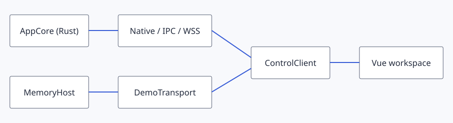

# Arquitectura de la aplicación y sus servicios {#application-and-service-architecture}

## Objetivo y requisitos {#goal-and-prerequisites}

Coloca cada cambio en el servicio propietario de su estado. Lee [preparación](setup.md) y distingue un host existente de uno independiente iniciado explícitamente. El escritorio construye un solo `AppCore`, lo envuelve en un `ControlApi` y expone esa instancia a WebView, CLI local y agentes.

## Seguir una operación {#trace-an-operation}

1. Busca el registro del método en `crates/tiktools-control-api/src/modules/`. Allí se definen esquemas, políticas y metadatos de descubrimiento.
2. Sigue el controlador hacia `crates/tiktools-core/src/control/` y el servicio propietario. La validación del dominio y las mutaciones persistentes pertenecen aquí, no al adaptador de transporte.
3. Añade el método tipado en `crates/tiktools-client`; la prueba de paridad compara la cobertura del SDK con la superficie registrada.
4. Consume el método mediante `src/web/shared/api/control-client.ts`. Las entidades Vue conservan estado de presentación; el escritorio no entrega a WebView una base de datos ni objetos de integraciones nativas.

Winit controla el bucle de eventos, Wry la WebView y la integración de bandeja su icono. `HostEmitter` y los eventos de dominio transportan valores serializados desde el núcleo. El escritorio los entrega mediante su proxy del bucle; la evaluación de scripts permanece en ese hilo. Tokio ejecuta las operaciones asíncronas del host.

## Comprobar un límite concreto {#concrete-boundary-check}

```sh
bun scripts/task.ts test web control-client
bun scripts/task.ts rust test -p tiktools-client --test parity --locked
```

La primera orden verifica el cliente frontend. La segunda ejecuta directamente el destino de integración que compara el SDK y el registro, conservando el archivo de bloqueo. No necesitas abrir una ventana para comprobar estos límites.

## Resultado esperado y estado {#expected-result-and-status}

Todos los clientes observan la misma operación autoritativa y el mismo recorrido de eventos. `host --ipc`, `host --stdio` y `--standalone` crean deliberadamente un propietario independiente; las órdenes CLI habituales se conectan al existente. `PageMessage`/`IpcRouter` permanece como compatibilidad y no debe recibir variantes nuevas.

## Recuperación {#recovery}

Si dos clientes discrepan, compara identidad del host, directorio de datos, características compiladas y descubrimiento antes de añadir otro almacén. Un plugin ausente es un problema del catálogo en ejecución, no una razón para compilarlo dentro del núcleo. Los documentos históricos contienen rutas frontend retiradas; ante diferencias, consulta el [núcleo actual](https://github.com/nglmercer/TikTools-app/blob/remake/crates/tiktools-core/src/lib.rs) y el [mapa frontend](frontend.md).


