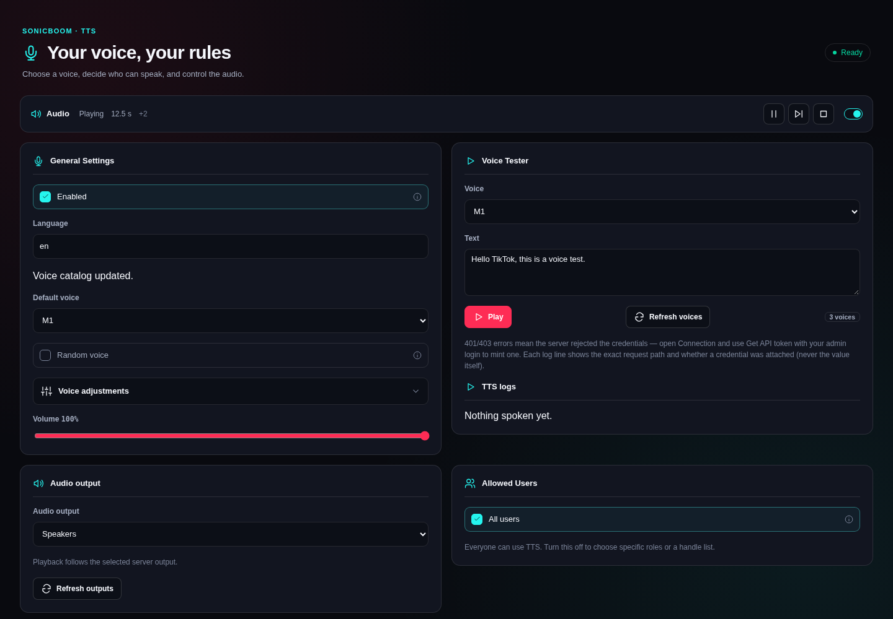
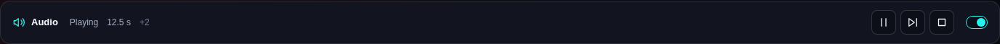
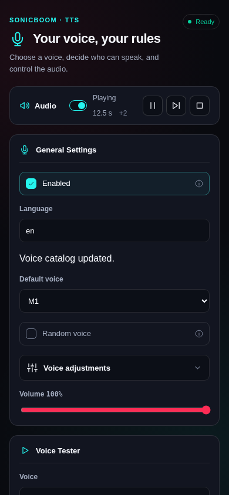

# Compact server audio bar

The playback card is now a single compact bar: Audio, playback state, reported
duration, queued count, icon controls, and an on/off switch. Queue IDs, shared-server
scope, and unavailable-duration explanations are available in titles instead of
persistent paragraphs. Buttons retain screen-reader names and hover titles. Errors
remain visible, and stale/unauthorized status still disables controls.

Before is the previous redesign at `9012228`. After uses the updated production
plugin build. Both desktop captures use Chromium at 1440 × 1000, English, dark
mode, and the same fake native broker. The queue and 12.5-second duration are test
data, not a live server. Mobile is 390 × 844.

| Before | After |
| --- | --- |
|  |  |

