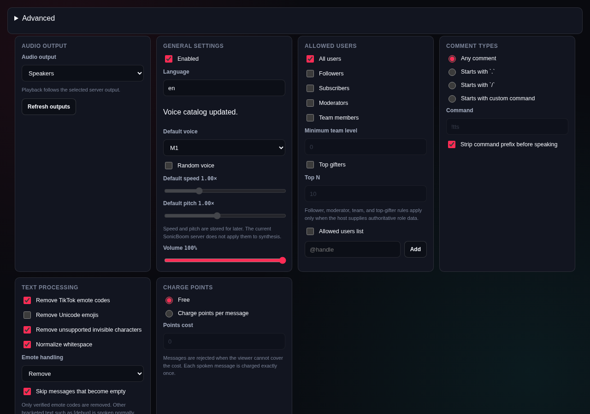
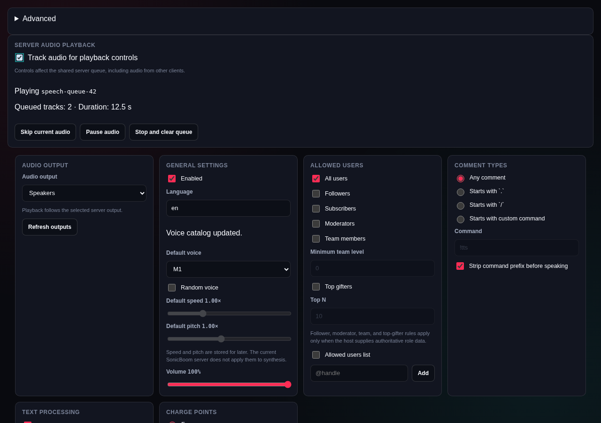
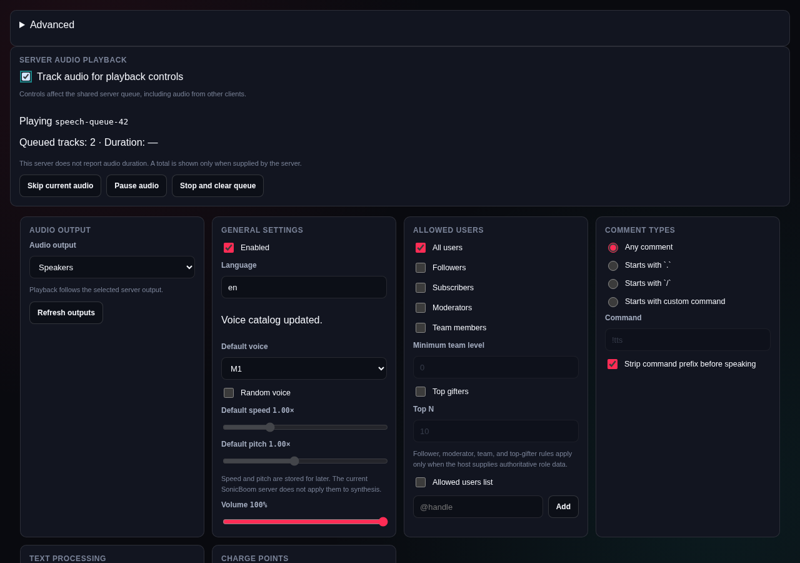

# TikTools TTS playback and token connection

Changes belong to the SonicBoom **plugin inside TikTools-app**. No changes to the
SonicBoom server are required.

Enable **Track audio for playback controls** in TTS to see the current queue ID,
waiting track count, and reported duration. Skip advances the current server audio;
Pause/Resume affects the current playback; Stop clears the current and waiting
server audio. These controls affect the shared server queue, including other clients.
Tracking is off by default and stops polling when disabled or the view unmounts.
Stale or failed status reads disable the controls.

Duration comes from server queue metadata when available, or the `audio_secs` of
TikTools observer-generated Pocket/Qwen jobs, matched by server, credential and
playback queue ID. The current server's queue API does not report duration or seek
position. Manual tests, legacy Supertonic speech and other-client tracks can therefore
show duration unavailable. No text-based duration estimate or synthetic seek bar
is presented.

In Connection, **Get API token…** now accepts the current SonicBoom Vue admin page's
HTML-escaped bootstrap data for CSRF and the one-time token, as well as legacy forms.
The password is not saved; only a strictly validated API token is stored. Provisioning
is disabled while connection edits are unsaved or another credential operation is active.

## Screenshots

Matching 1280 × 900 Chromium captures of the standalone TikTools plugin WebView,
English, dark theme. Before is the checked-in plugin build at `f4876d7`; after is
the updated plugin build. The native broker is a test fixture, with dummy queue IDs
and reported duration of 12.5 seconds. These demonstrate rendering, not a live
SonicBoom session or audible playback. Token compatibility is validated with a
real local HTTP stub login/mint/logout flow; the fix is behavioral.

| Before | After |
| --- | --- |
|  |  |

Unknown duration is explicit:

