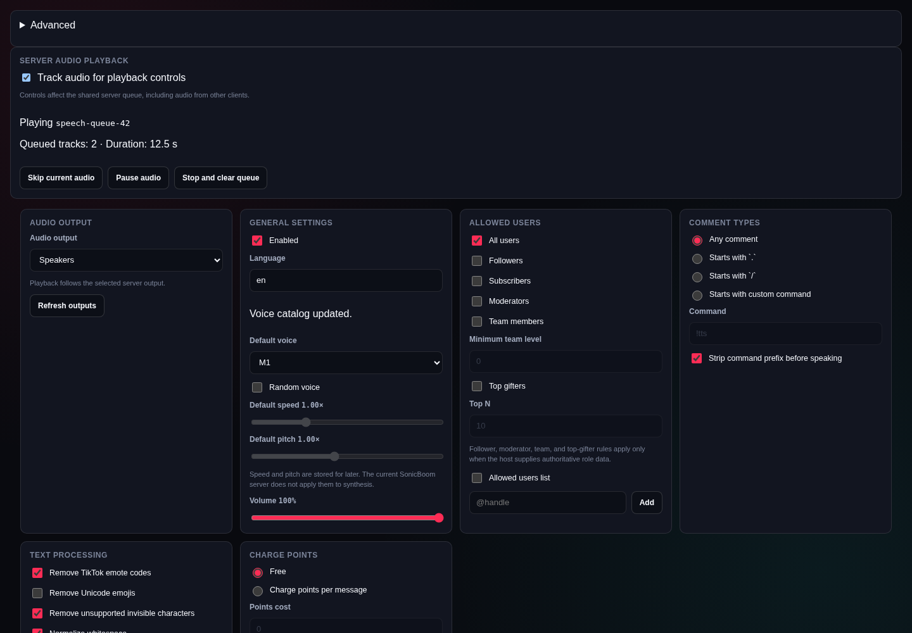
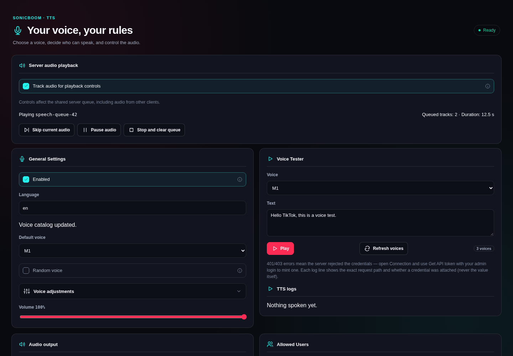
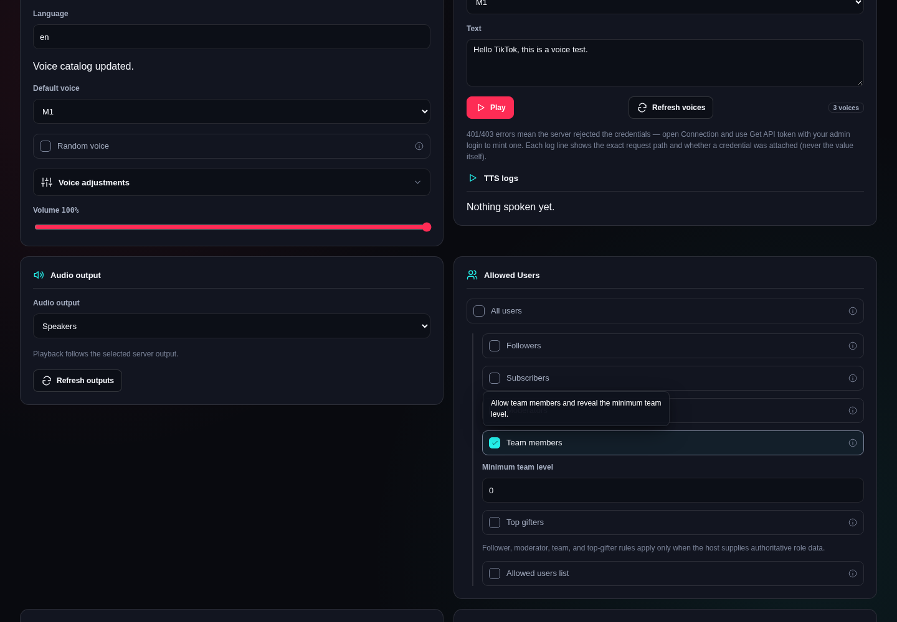
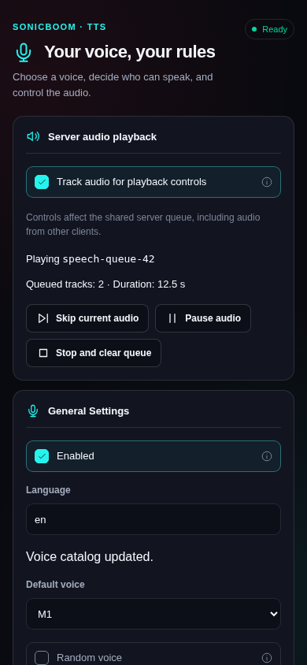

# TikTools TTS redesign

The TTS plugin now groups voice setup and the voice tester together, with a compact
playback card and separate audience, output, message-filter, and points groups.
SVG icons accompany visible labels. Native checkbox controls remain keyboard
operable; their hints appear on hover or focus and dismiss with Escape.

Dependent fields appear only when relevant, without deleting their saved values:

- Disable All users to configure audience roles and an allowlist.
- Enable Team members or Top gifters to show their numeric limits.
- Enable the allowlist to show the handle editor and saved handles.
- Choose custom command mode to show the command field; prefix stripping is
  hidden for unrestricted comments.
- Choose paid messages to show points cost.
- Enable emote cleanup to show its handling mode.

Text processing and per-user overrides use expandable groups. Existing overrides
start expanded. Unsupported speed/pitch sliders remain inside Voice adjustments,
with their existing explanation and disabled state.

## Review captures

Before: commit `c1e21ae` (the previous PR revision). After: the redesigned production
plugin build. Matching Chromium desktop captures use 1440 × 1000, English, dark
mode, and fake native-broker data. Queue ID and 12.5-second duration are fixtures;
no real credentials or live speech are used. The mobile capture uses 390 × 844.

| Before | After |
| --- | --- |
|  |  |

